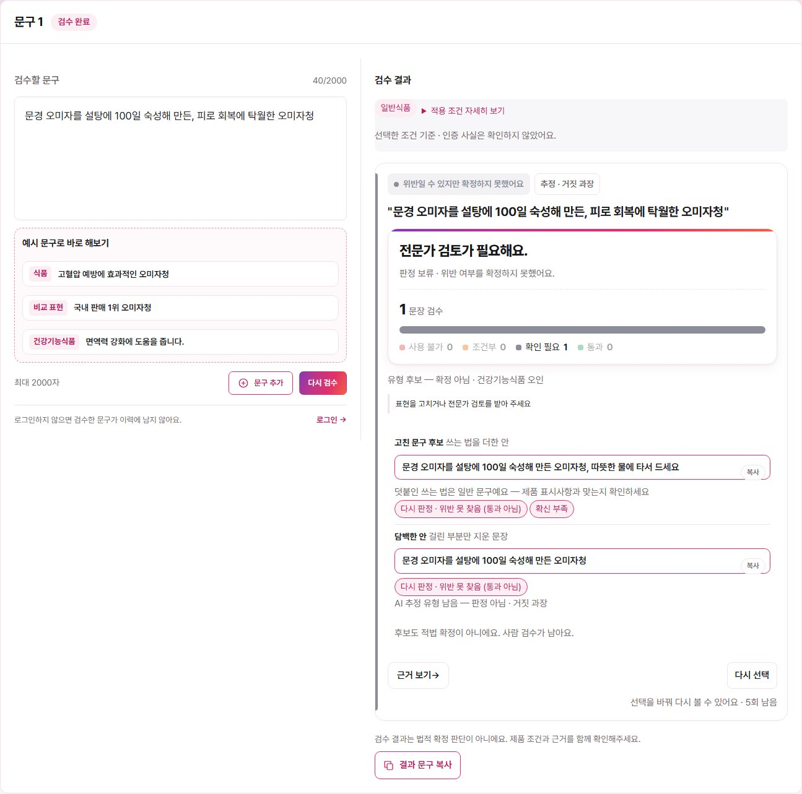
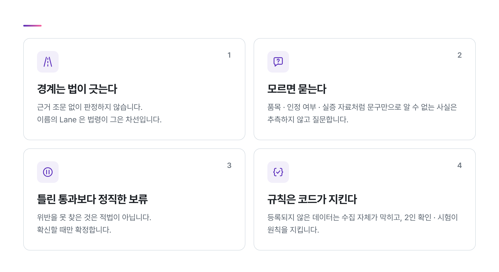
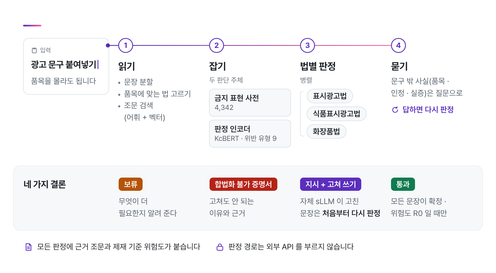
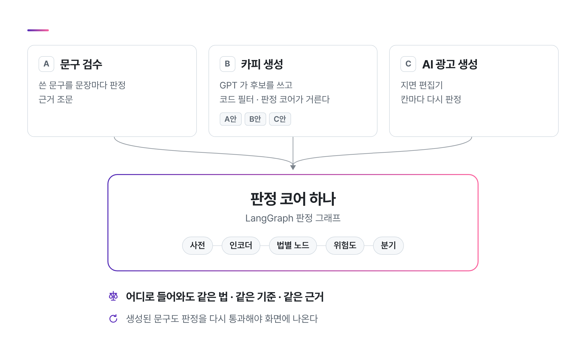
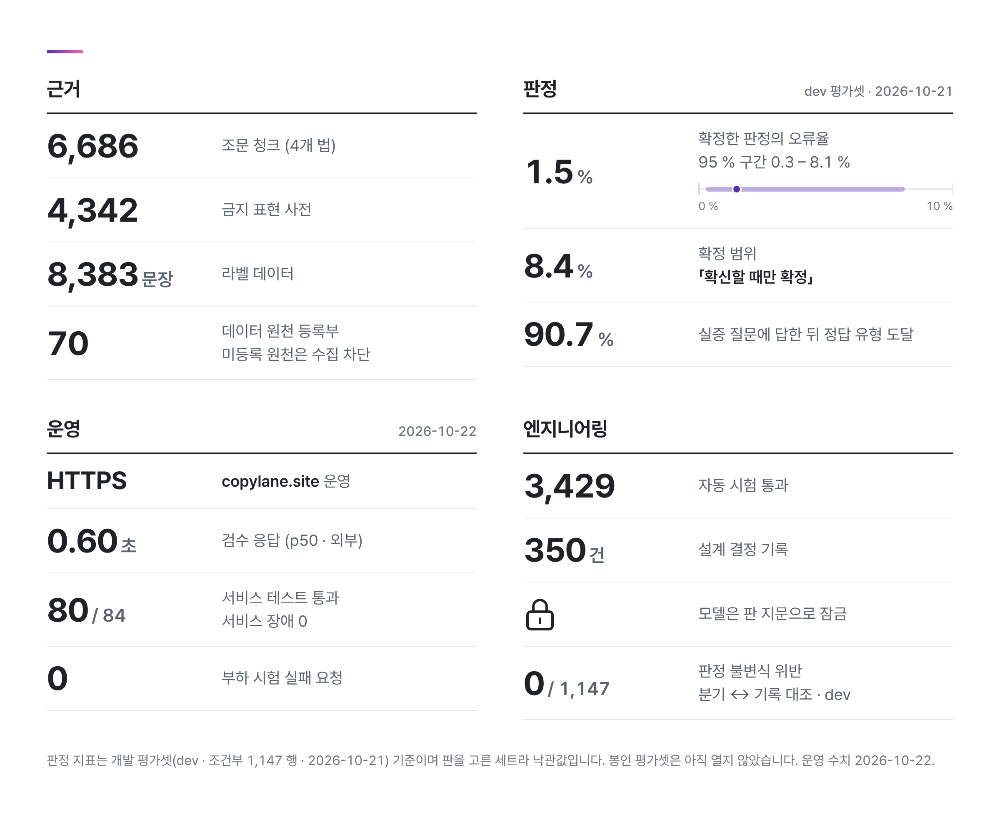
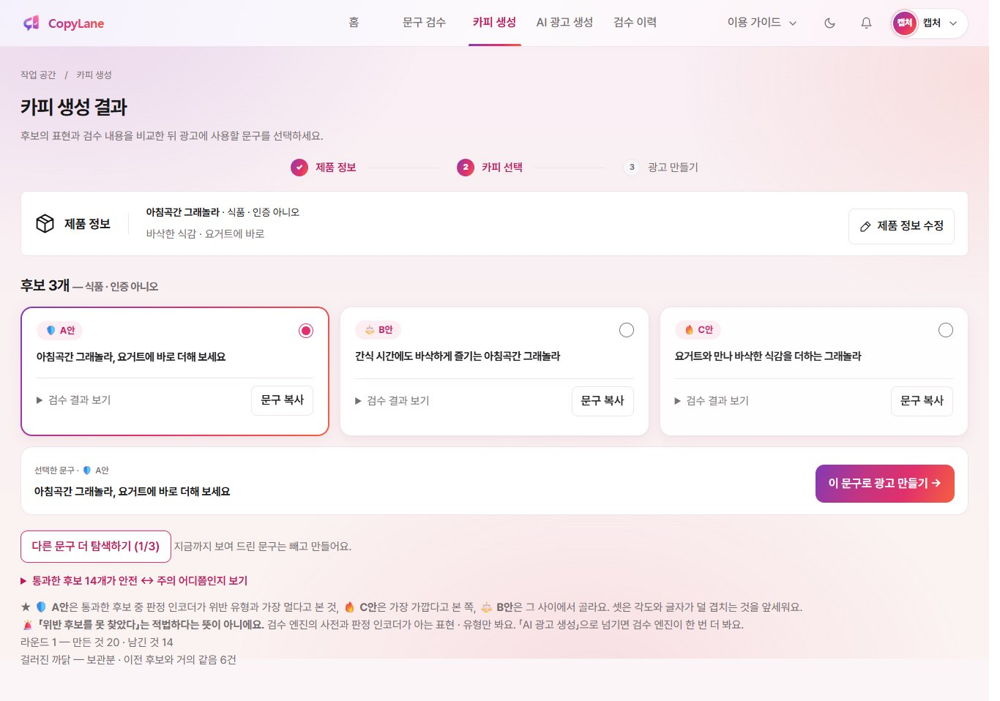

<div align="center">

<picture>
  <source media="(prefers-color-scheme: dark)" srcset="assets/brand/png/lockup-horizontal-reverse.png">
  
</picture>

### 광고 문구 한 줄이 나가기 전, 법 조문을 근거로 먼저 검수합니다

식품 · 건강기능식품 · 화장품 광고 문구를 **문장마다** 표시광고법 · 식품표시광고법 · 화장품법에 비춰 판정하고,<br>
**근거 조문 · 제재 기준 위험도**를 붙여 돌려줍니다. 고칠 수 있으면 고쳐 쓰고, 고친 문장은 **다시 판정**합니다.


<a href="https://copylane.site"></a>
&nbsp;
<a href="산출물/최종발표_2026-10-23/"></a>
&nbsp;
<a href="산출물/최종발표_2026-10-23/10_AI_시스템_아키텍처_양식_2026-10-23.docx"></a>

[설계 결정 350건](docs/00_설계결정기록.md) &nbsp;·&nbsp; [사실 원장](docs/00_사실원장.md) &nbsp;·&nbsp; [고지](DISCLAIMER.md)

</div>

<br>

<p align="center">
  
  <br>
  <sub>검수 화면 — 문장마다 판정과 근거가 붙고, 자체 sLLM 이 고친 후보도 <b>다시 판정</b>된 결과로만 보입니다.</sub>
</p>

> [!WARNING]
> **CopyLane 은 「이 문구는 합법입니다」라고 말하지 않습니다.** 사전 심의 전 1차 스크리닝 도구이며 법적 확정 판단이 아닙니다.
> 최종 판단은 심의기구 · 규제기관 · 법률 전문가의 검토를 따르십시오 — [DISCLAIMER.md](DISCLAIMER.md)

---

## 왜 필요한가

> *「위암 치료가 되는 양파즙」*

이 한 줄은 식품표시광고법상 **10년 이하 징역 또는 1억 원 이하 벌금** 사유입니다. 그런데 2026-08-30 에 실측한 기존 검사 도구는 이 문구를 기본 탭에서 **통과**시켰고, 「위암 치료에 최고인」에서는 「최고」만 잡았습니다 — 가장 무거운 위반을 놓치고 가벼운 최상급 표현만 잡는 **위험도 역전**입니다.

| | |
|:-:|---|
| **22,948건** | 최근 5년 건강기능식품 부당광고 적발 — 질병 예방 · 치료 표방이 34% |
| **5,214건** | 일반식품을 건강기능식품으로 오인시킨 광고, 2025년 8월까지 — 역대 최다 |
| **4개 법** | 같은 표현도 품목이 바뀌면 적용 법과 판단이 뒤집힙니다. 현장의 작성자는 대개 법률 전문가가 아닙니다 |

사전 심의는 건당 3 ~ 16.5만 원입니다. CopyLane 은 그 앞단에서 **근거와 함께 먼저 거르는** 소프트웨어입니다.

---

## 우리가 지키는 네 가지

<picture>
  <source media="(prefers-color-scheme: dark)" srcset="assets/readme/principles-dark.png">
  
</picture>

이름의 **Lane** 은 차선입니다. 차선은 우리가 긋지 않고 **법령이** 긋습니다 — 문구는 그 안에서만 움직입니다.
그래서 CopyLane 은 *더 많이 잡는 것*보다 **틀리게 통과시키지 않는 것**을 먼저 택했습니다. 위반을 못 찾은 문구는 「적법」이 아니라 「보류」이고, 확신이 서지 않으면 무엇이 더 필요한지 **묻습니다.**

---

## 어떻게 동작하나

<picture>
  <source media="(prefers-color-scheme: dark)" srcset="assets/readme/how-it-works-dark.png">
  
</picture>

- **두 판단 주체** — 금지 표현 사전은 「쓰는 것만으로 위반」인 표현을 확정하고, 판정 인코더(KcBERT 파인튜닝)는 사전이 놓친 위반 유형을 찾습니다. 위험도는 둘 중 높은 쪽, 근거는 둘 다 보여 줍니다.
- **품목을 몰라도 시작합니다** — 품목 · 건강기능식품 인정 여부 · 실증 자료처럼 문구 밖의 사실은 추측하지 않고 질문으로 받은 뒤, 그 답으로 다시 판정합니다.
- **고쳐 쓴 문장도 심사를 받습니다** — 자체 sLLM(Qwen3-4B + LoRA)이 고친 후보는 같은 판정 코어를 처음부터 다시 지나야 화면에 나옵니다.
- **판정 경로는 외부 API 를 부르지 않습니다** — 출시 전 문구가 외부 AI 서비스로 나가지 않습니다. 외부 LLM(GPT)은 카피 생성의 후보 작성에만 씁니다.

**위험도 R0 ~ R3** — 등급의 경계는 우리가 정하지 않고, 법이 정한 **처분 단계**가 긋습니다.

| 등급 | 뜻 | 경계가 된 처분 |
|:-:|---|---|
| **R0** | 특이사항 없음 | — |
| **R1** | 시정명령 위험 | 시정명령 |
| **R2** | 업무정지 위험 | 업무 · 영업정지 (갈음 과징금 포함) |
| **R3** | 영업 상실 위험 | 허가 취소 · 영업소 폐쇄 |

<sub>등급은 2인이 서명한 제재표에서 하한으로 계산하고, 사전 · 인코더 중 높은 쪽을 씁니다. 징역 · 벌금 같은 형벌은 이 축에 얹지 않고 따로 표시합니다. 「통과」는 모든 문장이 확정이고 R0 일 때뿐입니다.</sub>

---

## 믿을 수 있게 만든 장치

원칙은 말로 두지 않고 **코드 · 계약 · 시험이 강제하게** 했습니다. 아래는 모두 저장소 안의 위치를 가리킬 수 있는 장치입니다.

**판정 — AI 가 지어내지 못하게**

| 원칙 | 무엇이 그것을 지키나 |
|---|---|
| **판정은 생성하지 않는다** | 판정 경로에는 생성형 LLM 이 없습니다 — 사전 · 인코더 · 규칙만 씁니다. 판정 경로가 외부 호출 층을 import 하면 시험이 실패합니다 (`tests/test_judge_path_offline.py`) |
| **근거 없는 판정은 응답이 될 수 없다** | 위험도를 올리려면 근거 조문 · 호가 붙어야 하고, 인코더만으로는 R1 을 넘지 못합니다 — 어기면 Pydantic 계약이 응답을 거부합니다 (`app/contracts.py`) |
| **AI 가 쓴 문장은 다시 심사받는다** | 자체 sLLM 의 고쳐 쓰기도, GPT 의 카피 후보도 같은 판정 코어를 처음부터 다시 지나야 화면에 나옵니다 |
| **입력에 없는 사실은 쓰지 못한다** | 카피 생성의 코드 필터가 입력에 없는 수치 · 인증 · 시험 사실 · 성분이 들어간 후보를 떨굽니다 (`app/routers/copygen/filters.py`) |

**실패 — 없으면 없다고 말한다 (fail-closed)**

| 원칙 | 무엇이 그것을 지키나 |
|---|---|
| **없음은 성공이 아니다** | DB · 엔진이 없으면 그럴듯한 결과 대신 503 · 501 을 냅니다. sLLM 이 없으면 후보를 지어내지 않습니다. 위반을 못 찾아도 통과가 아니라 보류입니다 |
| **불변식이 판정을 지킨다** | 품목 · 사실 분기와 기록 판정이 어긋나면 운영에서는 보류로 내리고 시험에서는 거부합니다 — dev 1,147 행에서 불변식 위반 0, 분기를 접든 펼치든 같은지 본 668 쌍에서 어긋남 0 |

**측정 · 추적 — 숫자를 믿을 수 있게**

| 원칙 | 무엇이 그것을 지키나 |
|---|---|
| **평가셋으로 채점 규칙을 고르지 않는다** | 판을 고르는 dev 와 마지막에 한 번만 여는 봉인 평가셋(1,141 행)을 나눴고, 봉인셋은 정해진 절차 밖에서 열리지 않습니다 (`scripts/sealed_log.py`). 채택 조건은 측정 **전에** 고정합니다 |
| **모자란 표본은 「측정 불가」** | 표본이 30 에 못 미치는 항목은 좋다고도 나쁘다고도 적지 않습니다 (D-40) |
| **모든 수에 출처가 있다** | 수치는 [사실 원장](docs/00_사실원장.md) 한 곳에 측정 기기 · 조건과 함께, 판단은 [설계 결정](docs/00_설계결정기록.md) 350 건에 대안 · 기각 이유와 함께 남깁니다. 모델은 판 지문으로 잠가 같은 판만 올라갑니다 |
| **법의 시행일을 안다** | 공포됐지만 아직 시행 전인 조항(예: 식품등의 표시기준 2028-01-01 시행분)은 「시행 예정」 표시와 함께 싣고, 원문이 바뀌어 그 조항을 찾지 못하면 적재가 멈춥니다 (`preprocess/law_article.py`) |
| **문구는 로그에 남지 않는다** | 광고 문구는 로그에 길이와 지문만 남기고, 판정 경로는 외부 AI 서비스를 부르지 않습니다 (`app/logging_conf.py`) — 출시 전 문구를 다루는 도구라서입니다 |

---

## 입구는 셋, 판정 기준은 하나

<picture>
  <source media="(prefers-color-scheme: dark)" srcset="assets/readme/one-core-dark.png">
  
</picture>

| 입구 | 누구에게 | 하는 일 |
|:-:|---|---|
| **A 문구 검수** | 이미 쓴 문구가 있는 사람 | 문장별 판정 · 근거 조문 · 위험도 → 보류 · 합법화 불가 증명서 · 지시 · 통과, 그리고 고쳐 쓰기 |
| **B 카피 생성** | 아직 문구가 없는 사람 | GPT 가 후보를 쓰고 → 코드 필터 → 판정 코어가 거른 뒤 A안 · B안 · C안 (회원 전용) |
| **C AI 광고 생성** | 지면에 앉히려는 사람 | 판정 결과와 함께 문구를 SNS 피드 · 상세페이지 · 배너 편집기에 얹고(확인이 필요한 문장은 표시), 칸을 고칠 때마다 다시 판정 |

어디로 들어와도 **같은 법 · 같은 기준 · 같은 근거**로 잽니다. 기능이 늘어도 판정 기준은 한 곳에서만 바뀝니다.

**법을 더하기 쉬운 구조** — 법마다 판정 노드를 따로 두고, 품목 → 적용 법은 라우팅 표(`LAW_SCOPE` · `LAW_OF_NODE` · `app/graph.py`)가 정합니다. 새 법은 이 표에 줄을 더하고 그 법의 노드 · 조문 · 제재표를 붙이는 일이라 기존 법의 판정을 건드리지 않습니다. 표와 노드가 어긋나면 앱이 시작하지 않습니다. 기획상 다음 확장 1순위는 의료기기 광고입니다.

---

## 숫자로 본 CopyLane

<picture>
  <source media="(prefers-color-scheme: dark)" srcset="assets/readme/results-dark.png">
  
</picture>

> [!NOTE]
> **확정 범위가 8.4 % 로 좁은 것은 설계의 결과입니다.** CopyLane 은 확신이 설 때만 「위반 확정」을 내고, 나머지는 근거 · 위험도 · 질문과 함께 보류로 돌려줍니다 — 그렇게 확정한 판정의 오류율이 1.5 % 입니다.
> 판정 지표는 개발 평가셋(dev · 조건부 1,147 행 · 2026-10-21) 기준이며 판을 고른 세트라 낙관값입니다. 봉인 평가셋은 아직 열지 않았습니다. 모든 수의 출처와 측정 조건은 [사실 원장](docs/00_사실원장.md)에 있습니다.

<details>
<summary><b>카피 생성 화면 보기</b></summary>
<br>
<p align="center"></p>
<p align="center"><sub>카피 생성 — GPT 후보 → 코드 필터 → 판정 코어. 남은 후보도 「위반 후보를 못 찾음」이지 적법 확인이 아닙니다.</sub></p>
</details>

---

## 엔지니어링 하이라이트

<sub>각 항목은 제목을 눌러 접을 수 있습니다.</sub>

<details open>
<summary><b>판정 — LangGraph 상태 그래프</b></summary>
<br>

- 문장 분할 → 품목 · 적용 법 → 조문 검색(어휘 + 벡터 RRF) → 사전 → 인코더 → **법별 노드 병렬 팬아웃** → 합치기 → 판정 · 위험도 → 품목 · 사실 분기 → 참고 조문 → 종착(보류 > 증명서 > 지시 > 통과)
- 위험도는 **서명된 제재표**의 하한으로 계산합니다(R0 ~ R3). 2인이 서명하지 않은 행은 판정에 쓰이지 않습니다.
- 계약(Pydantic)이 응답을 막아 세웁니다 — 인코더 하한은 R1 을 넘지 못하고, 근거 없는 위험도는 응답이 될 수 없습니다.
- 자세히 → [10 AI 시스템 아키텍처](산출물/최종발표_2026-10-23/10_AI_시스템_아키텍처_양식_2026-10-23.docx) · [07 멀티에이전트 테스트](산출물/최종발표_2026-10-23/07_멀티에이전트_테스트_계획_및_결과_보고서_양식_2026-10-23.docx)

</details>

<details open>
<summary><b>데이터 거버넌스 — 수집보다 먼저, 코드로</b></summary>
<br>

- 원천마다 등급 · 용도(학습 · 검색 · 화면 인용 · 배포) · 2인 확인 이력을 등록부(`data_sources.yaml`)에 적고, **미등록이거나 배제된 원천은 수집 자체가 실행되지 않습니다**(`collect/registry.py`).
- 업체명 · 상표 · 대표자명은 등급과 무관하게 마스킹하고, 재배포가 제한된 원문은 저장소와 배포물에 들어가지 않습니다.
- 문장 단위 대량 라벨이 없다는 리스크는 승인 문구에 고시의 금지 유형을 규칙으로 주입한 **결함 주입 골든셋**으로 우회했습니다.
- 자세히 → [03 수집 데이터 보고서](산출물/최종발표_2026-10-23/03_수집_데이터_보고서_양식_2026-10-23.docx) · [04 전처리 결과서](산출물/최종발표_2026-10-23/04_데이터_전처리_결과서_양식_2026-10-23.docx)

</details>

<details open>
<summary><b>모델 — 인코더 · 임베딩 · 자체 sLLM</b></summary>
<br>

| 모델 | 무엇 | 쓰임 |
|---|---|---|
| 판정 인코더 D4-20 | KcBERT 파인튜닝 · (품목, 문장) 입력 · 위반 유형 9 | 사전이 놓친 위반 유형 · 확신 문턱을 넘을 때만 확정 |
| KURE-v1 | 1024차원 임베딩 · 조문 청크 6,686 | 조문 검색(어휘 + 벡터) |
| 자체 sLLM | Qwen3-4B-Instruct + LoRA | 검수 화면 「고쳐 쓰기」 — 고친 안은 다시 판정 |

모든 모델은 `models.lock.json` 의 **판 지문으로 잠급니다** — 잠금에 없는 판은 앱이 불러오지 않습니다.
자세히 → [05 학습 결과서](산출물/최종발표_2026-10-23/05_ML_DL_학습_결과서_양식_2026-10-23.docx) · [06 모델 명세](산출물/최종발표_2026-10-23/06_학습한_ML_DL_모델_양식_2026-10-23.docx) · [09 자체 sLLM](산출물/최종발표_2026-10-23/09_자체_sLLM_인공지능_양식_2026-10-23.docx)

</details>

<details open>
<summary><b>운영 — 배포 · 보안 · 측정</b></summary>
<br>

- AWS g4dn.xlarge(T4) · RDS PostgreSQL 16 · Caddy HTTPS · 서버는 `main` 에 들어간 커밋만 배포합니다.
- 보안 헤더(CSP) · Argon2id 비밀번호 해시 · 관리자 화면 IP 제한 · 내부 포트 외부 차단 · 비밀값 커밋 검사(gitleaks).
- 부하 시험(2026-10-22): 검수 p50 0.56 초(서버) / 0.60 초(외부) · 실패 0 · 서비스 테스트 84 항목 중 80 통과(실패 2 는 시험 조건 문제 · 서비스 장애 0).
- 남은 일도 숨기지 않습니다 — 요청 횟수 제한 · 개인정보처리방침 게시 · 접속기록 보관은 아직입니다.
- 자세히 → [11 웹 애플리케이션](산출물/최종발표_2026-10-23/11_개발된_LLM_연동_웹애플리케이션_양식_2026-10-23.docx) · [12 서비스 테스트](산출물/최종발표_2026-10-23/12_서비스_테스트_계획_및_결과_보고서_양식_2026-10-23.docx) · [13 시스템 구성도](산출물/최종발표_2026-10-23/13_시스템_구성도_양식_2026-10-23.docx)

</details>

<details open>
<summary><b>기술 스택</b></summary>
<br>

Python 3.11 · uv · FastAPI · Jinja2 · LangGraph · Pydantic · PostgreSQL 16 + pgvector · SQLAlchemy · Alembic · KURE-v1 · KcBERT · Qwen3-4B + LoRA · GPT API(카피 생성만) · pytest · GitHub Actions · pre-commit · ruff · gitleaks · Docker · Caddy · systemd · AWS(EC2 · RDS)

</details>

---

## 빠르게 돌려 보기

```bash
git clone https://github.com/SKNETWORKS-FAMILY-AICAMP/SKN32-FINAL-3TEAM.git
cd SKN32-FINAL-3TEAM
setup.bat                              # Windows — 더블클릭
uv run python launcher.py onboard      # 환경 · 훅 · 로컬 DB 를 세우고 끝에 상태를 판정합니다
uv run python launcher.py              # 대화형 메뉴 (서버 실행 · 검사 · 데이터 명령)
```

> [!IMPORTANT]
> **데이터와 모델 가중치는 저장소에 없습니다.** 재배포가 제한된 자료가 섞여 있어 `data/**` 는 커밋하지 않고, 무엇을 언제 받았는지의 **이력(원장)만** 남깁니다. 클론 직후에는 시험 · 스키마 · API 기동 · 고정 응답 · 문서가 동작하고, 실제 판정에는 팀 저장소의 파생물과 잠금된 모델이 필요합니다.

---

## 저장소 구조

<details>
<summary><b>펼쳐 보기</b></summary>

<br>

```
├── launcher.py            ★ 작업 진입점 — 대화형 메뉴 + 직접 실행
├── setup.bat / setup.ps1  부트스트랩 (환경 · 훅 · DB · 게이트)
├── app/                   FastAPI · 판정 계약(Pydantic) · LangGraph 판정 그래프
│   ├── api.py             판정 코어 API — /judge · /search (/generate · /compose 는 501)
│   ├── graph.py           ★ 판정 코어 서브그래프 + 검수 · 생성 그래프
│   ├── contracts.py       ★ 판정 계약 — 판정 · 보류 종류 · 위험도 · 종착
│   ├── retrieve.py        조문 검색 — 어휘 + 벡터 RRF
│   ├── encoder.py         판정 인코더 로더 (가중치는 저장소 밖 · 잠금 판만)
│   ├── routers/           화면 · BFF — 사용자 · 관리자 · 고쳐 쓰기(sLLM) · copygen/(카피 생성)
│   └── templates/ static/ Jinja2 화면 · 정적 파일
├── collect/               수집기 — 등록부 게이트 · 무손상 저장 · 원장
├── preprocess/            추출 · 마스킹 · 정규화 · 청킹 · 골든셋
├── scripts/               적재 · 임베딩 · 평가 · 모델 잠금 · 진단
├── db/                    schema.sql (데이터층 19표) + migrations/
├── alembic/               마이그레이션 (0001 ~ 0027)
├── tests/                 거버넌스 게이트 포함 자동 시험
├── experiments/           실험 설정 틀
├── data/                  등급별 물리 분리 — 위치가 곧 게이트 (원장만 커밋)
├── data_sources.yaml      데이터 원천 등록부 (생성물)
├── models.lock.json       모델 잠금 — 판 지문 · 파일별 sha256
├── assets/                brand/ 브랜드 · diagrams/ 도면 · readme/ 이 문서의 그림(src/ 원천 포함)
├── 산출물/                 최종 산출물 14종 (최종발표_2026-10-23)
├── 발표자료/               발표 자료
└── docs/                  설계 결정 기록 · 사실 원장 · 거버넌스 집행계약 · 개인 작업 폴더
```

</details>

---

## 산출물

| | 문서 | | 문서 |
|:-:|---|:-:|---|
| 01 | [프로젝트 기획서](산출물/최종발표_2026-10-23/01_프로젝트_기획서_양식_2026-10-23.docx) | 08 | [벡터DB · GraphDB 구축 결과서](산출물/최종발표_2026-10-23/08_벡터DB_GraphDB_구축_결과서_양식_2026-10-23.docx) |
| 02 | [데이터베이스 · 저장소 설계](산출물/최종발표_2026-10-23/02_데이터베이스_저장소_설계_문서_양식_2026-10-23.docx) | 09 | [자체 sLLM](산출물/최종발표_2026-10-23/09_자체_sLLM_인공지능_양식_2026-10-23.docx) |
| 03 | [수집 데이터 보고서](산출물/최종발표_2026-10-23/03_수집_데이터_보고서_양식_2026-10-23.docx) | 10 | [AI 시스템 아키텍처](산출물/최종발표_2026-10-23/10_AI_시스템_아키텍처_양식_2026-10-23.docx) |
| 04 | [데이터 전처리 결과서](산출물/최종발표_2026-10-23/04_데이터_전처리_결과서_양식_2026-10-23.docx) | 11 | [LLM 연동 웹 애플리케이션](산출물/최종발표_2026-10-23/11_개발된_LLM_연동_웹애플리케이션_양식_2026-10-23.docx) |
| 05 | [ML · DL 학습 결과서](산출물/최종발표_2026-10-23/05_ML_DL_학습_결과서_양식_2026-10-23.docx) | 12 | [서비스 테스트 계획 · 결과](산출물/최종발표_2026-10-23/12_서비스_테스트_계획_및_결과_보고서_양식_2026-10-23.docx) |
| 06 | [학습한 ML · DL 모델](산출물/최종발표_2026-10-23/06_학습한_ML_DL_모델_양식_2026-10-23.docx) | 13 | [시스템 구성도](산출물/최종발표_2026-10-23/13_시스템_구성도_양식_2026-10-23.docx) |
| 07 | [멀티에이전트 테스트 계획 · 결과](산출물/최종발표_2026-10-23/07_멀티에이전트_테스트_계획_및_결과_보고서_양식_2026-10-23.docx) | 14 | [요구사항 정의서](산출물/최종발표_2026-10-23/14_요구사항_정의서_양식_2026-10-23.xlsx) |

설계의 모든 갈림길은 [설계 결정 기록](docs/00_설계결정기록.md)(D-01 ~ D-350 · 맥락 · 대안 · 왜 기각했는지)에, 모든 수치는 측정 기기 · 조건과 함께 [사실 원장](docs/00_사실원장.md)에 있습니다. 문서에 적힌 수는 원장의 사본입니다.

---

## 팀 한끗

**SK네트웍스 Family AI 캠프 32기 · 3팀**

| | 맡은 일 |
|---|---|
| **오한빈** (팀장) | 판정 코어 · 판정 그래프 · 데이터 파이프라인 · DB 설계 · 거버넌스 게이트 · 평가 · CI · 보안 · 문서 · 통합 |
| **권소라** | 사용자 화면 · 카피 생성 엔진 · 데이터 수집 · 서비스 테스트 · 도메인 제안 |
| **이서은** | 사용자 화면 · 대체 문구 생성(고쳐 쓰기) · 자체 sLLM 파인튜닝 |
| **소성민** | 관리자 화면 · 배포 · 운영(주담당) · 판정 인코더 파인튜닝 |
| **박수진** | 관리자 화면 · 판정 인코더 파인튜닝(채택 판 D4-20) |

---

<details>
<summary><b>English summary</b></summary>
<br>

**CopyLane** screens Korean food, health-functional-food and cosmetics ad copy **sentence by sentence** against the relevant statutes, and returns each verdict with the **cited article and a sanction-based risk level**. A LangGraph judgment core combines a curated prohibited-expression dictionary with a fine-tuned KcBERT encoder, fans out per statute, and asks the user for facts the copy alone cannot establish (product category, certification, substantiation) before re-judging. Rewrites from an in-house LoRA-tuned Qwen3-4B must pass the same core again. The design favors **honest holds over false passes**: it confirms only when confident (8.4 % coverage at 1.5 % error on the dev set), keeps the judgment path free of external API calls, and enforces data governance in code. Deployed over HTTPS on AWS; 3,429 automated tests; 350 recorded design decisions.

</details>

## 고지 · 라이선스

- [DISCLAIMER.md](DISCLAIMER.md) — 이 도구가 무엇이 아닌지, 알려진 한계. **사용 전 반드시 읽어 주십시오.**
- [NOTICE.md](NOTICE.md) — 권리 고지. 소스코드 · 문서 · 도면의 무단 도용 및 사용을 금지합니다.
- 라이선스는 보류 중이며(D-60), 그동안 저작권법 기본값인 「모든 권리 유보」가 적용됩니다.
- 제재 사례의 피심인 상호 · 대표자명 · 주소는 파생 데이터를 만들 때 마스킹하며, 이 프로젝트는 특정 사업자의 위법을 지목할 목적으로 만들어지지 않았습니다.
