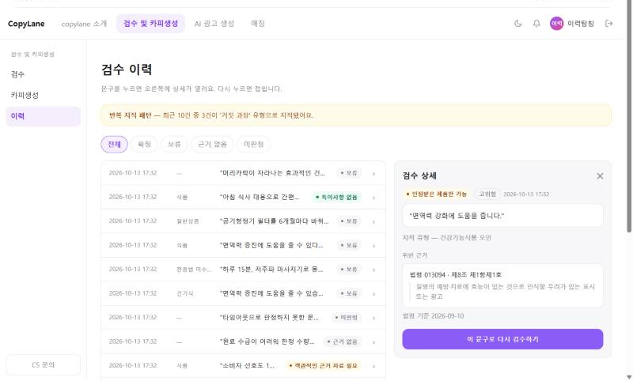
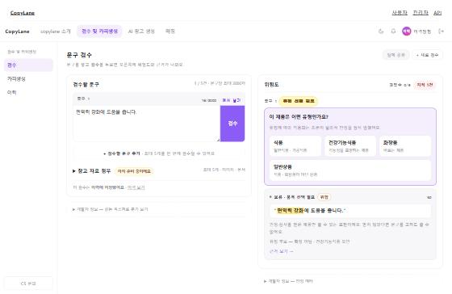

# 검수 이력 — 저장과 화면 (ksr · 2026-10-13)

검수(`/u/review`)에서 판정한 결과가 이력(`/u/history`)에 쌓이도록 연결했다.
코드는 `app/routers/user.py` 의 `_keep_history` · `_save_review` · `_hist_view`, 화면은 `app/templates/user/history.html` 이다.

## 1. 어떤 기능이 있나

**저장**

| 무엇 | 어떻게 |
|---|---|
| 적는 시점 | 검수에서 판정이 끝났을 때만. 고쳐 쓰기의 재판정 · 카피 생성 · 광고 생성은 적지 않는다 |
| 누구 것 | **로그인 + 마이페이지 › 계정의 「① 검수 이력 보관」을 켠 회원**만 (D-96). 비회원은 적지 않는다 (D-69) |
| 단위 | 문구 하나 = 문서(`work_doc`) 하나 · 문장 하나 = 판정(`judgment`) 하나 = 이력 한 줄 |
| 빼는 것 | 「판정 대상 아님」 문장 — 표에 그 칸이 없어 적으면 「특이사항 없음」으로 읽힌다 |
| 실패하면 | 검수 결과는 그대로 그리고 「이력에 저장하지 못했어요」라고 알린다 |

검수 화면 입력 카드 아래에 결과가 한 줄로 뜬다 — 「이력에 저장됐어요」 / 「보관이 꺼져 있어 남지 않아요」 / 「저장하지 못했어요」.

**이력 화면** (프로토타입 v7.2 의 이력 화면을 따랐다)

- 목록 한 줄 = 날짜 · 품목 · 문구 · 결과 배지. 배지 글자는 검수 화면의 문장 카드와 같다.
- 줄을 누르면 오른쪽에 상세 — 배지 · 위험도 · 문구 · 보류 사유 · 지적 유형 · 근거 조문 · 법령 기준.
- 「이 문구로 다시 검수하기」 — 문구를 검수 입력칸에 담기만 한다. 판정은 「검수」를 눌러야 돈다.
- 반복 지적 패턴 띠 — 내 최근 10건 중 같은 위반 유형이 3건 이상일 때만 뜬다.
- 필터 — 전체 · 확정 · 보류 · 근거 없음 · 미판정. 20건씩 페이지.
- 내 것만 보인다. 로그아웃이면 로그인 안내, 보관이 꺼져 있으면 그 안내가 뜬다.
- 홈의 「최근 검수 이력」 3건도 같은 배지를 쓴다.
- 질의응답은 넣지 않았다 (검수 화면에서도 뺀 결정 · 저장할 표 없음).

## 2. 어떻게 보이나

이력 목록과 상세 (픽스처 판정을 넣어 찍은 것):

검수 직후 — 입력 카드 아래 「이 검수는 이력에 저장됐어요 · 이력 보기」:

## 3. 무엇이 바뀌면 다시 손봐야 하나

이력은 판정 엔진이 내놓는 **응답(`JudgeResponse`)만 받아 적는다.**

**손볼 필요 없는 것**

- 인코더 모델 교체 · 재학습, 판정 엔진 내부 로직 변경, 사전 · 검색 변경.
  새 버전 이름은 `judged_by` · `law_version` 에 그대로 찍힌다. 지난 이력은 그때 판정 그대로 남고 다시 판정되지 않는다.

**손봐야 하는 것 — 응답의 모양(계약)이 바뀔 때**

| 바뀌는 것 | 손볼 곳 | 안 고치면 |
|---|---|---|
| 보류 사유에 새 값 | `_HOLD_LABELS` 한 줄 (`review.html` 의 `HOLD` 와 같은 글자) | 「알 수 없는 값」으로 뜬다. 이름이 16자를 넘으면 저장이 거부된다 |
| 불가 사유(A/B/C)에 새 값 | `_INF_BADGES` 한 줄 | 「위반 확정」으로 뭉친다 |
| 검수 화면의 판정 문구를 바꿈 | `_INF_BADGES` · `_hist_view` 의 글자도 같이 | 검수 화면과 이력이 다른 말을 한다 |
| 판정 상태(확정 · 보류 …)에 새 값 | `_VERDICTS` · `_VERDICT_LABELS` + DB 제약(팀장) | 저장이 거부된다 |
| `judgment` 표의 CHECK · 칸 길이 변경 | `_save_review` | 저장이 거부된다 — 검수 결과는 나오고 「저장하지 못했어요」가 뜬다 |
| 응답의 칸 이름 · 구조 변경 (`sentences` · `verdict` · `risk` · `evidence` …) | `_save_review` | 저장 단계에서 오류 — 검수 화면도 같이 고쳐야 하는 변경이다 |
| 근거 조문(`EvidenceArticle`)의 칸 변경 | `history.html` 의 근거 줄 | 근거가 비어 보인다 |

게이트 `tests/test_user_history_save.py` 가 판정 픽스처 전부를 저장해 보므로, 픽스처가 따라 바뀌는 계약 변경은 여기서 먼저 걸린다.

## 4. 남은 것

1. **동의를 끈 뒤의 기존 이력** — 지금은 ①을 꺼도 이미 쌓인 이력이 그대로 보인다. 지우려면 삭제 동작이 필요하다.
2. **`judgment.evidence` 의 쓰임** — 표에 불가 사유 칸이 없고 위반 유형은 한 칸이라, 유형 전체와 사유를 이 칸(JSONB)에 조문과 함께 넣었다
   (`{"articles": […], "violations": […], "infeasibility": "A"}`). 모델 파일은 건드리지 않았다 — 팀장 확인 필요.
3. 뺄 구간(`spans`)은 담을 칸이 없어 적지 않는다 — 이력 상세에서는 걸린 곳이 칠해지지 않는다.
4. `docs/04_보안/보안점검.md` 263행의 「`work_doc` · `judgment` 를 쓰는 코드가 없다」는 이제 사실과 다르다.
5. 서버를 `--reload` 없이 띄웠으면 **재시작해야** 이 변경이 붙는다 — 안 하면 이력 화면이 500 이다 (옛 코드 + 새 템플릿).
