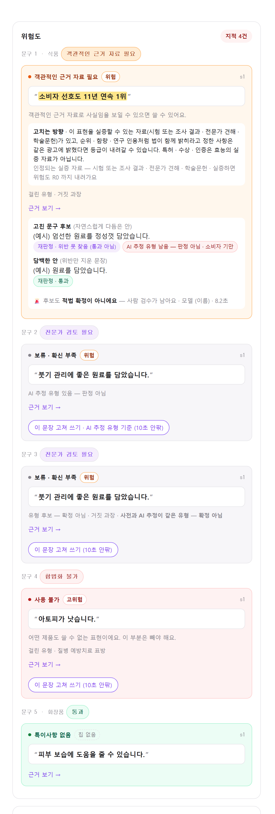
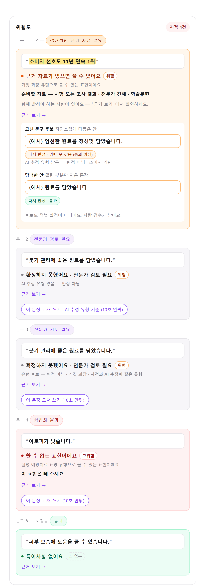
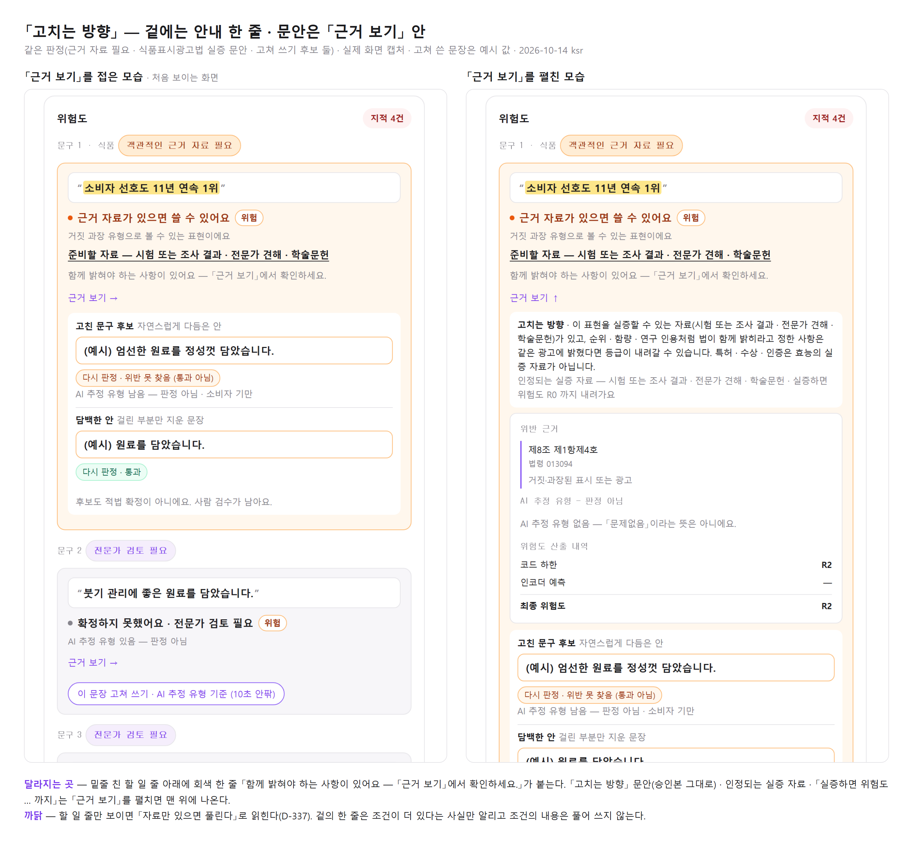

# 검수 화면 문장 카드 — 변경 내용 (ksr · 2026-10-14)

검수 화면(`/u/review`)의 문장 카드를 「문장 → 결론 → 이유 → 할 일 → 근거 보기 → 고쳐 쓰기」 순서로 다시 짰다.
오한빈 님이 부탁한 표지 셋(`app/reasons.py`)의 문안 · 자리 다듬기도 여기에 들어 있다.

- **판정은 바뀌지 않는다.** 같은 판정 값을 다른 순서 · 다른 말로 그릴 뿐이다.
- **상태** — 코드 반영 · 전체 테스트 통과(2541 passed · 5 skipped · 6 xfailed) · ksr 에 올렸다. 팀장 판정은 받지 않았다.
- **확인받을 곳** — 맨 아래 「확인이 필요한 것」.

## 전 / 후

같은 판정 다섯 개를 변경 전 코드(ksr @826f1be)와 변경 후 코드로 각각 그린 실제 화면이다.
판정은 골든 픽스처이고, 인코더 후보와 고쳐 쓰기 결과(「(예시)」 문장 · 모델 이름 · 시간)는 화면을 띄우려고 얹은 가짜 값이다. 「고치는 방향」 문안은 식품표시광고법 승인본(`SUBST_TEXT`)을 넣었다.

| 변경 전 | 변경 후 |
|---|---|
|  |  |

위에서부터 — 근거 자료 필요(고쳐 쓰기 후보 둘) · AI 추정 유형만 있는 보류 · 사전과 AI 추정이 같은 보류 · 사용 불가 · 특이사항 없음.

## 무엇을 왜 바꿨나

| # | 기존 내용 | 변경 사유 | 변경 내용 |
|---|---|---|---|
| 1 | 결론이 카드 머리의 짧은 딱지였다(「객관적인 근거 자료 필요」 · 「사용 불가」 · 「보류 · 확신 부족」). 같은 뜻의 회색 설명 줄이 문장 아래에 한 번 더 나왔다. | 같은 말이 두세 번 나왔고, 딱지만 보고는 「써도 되는지」가 읽히지 않았다. | 결론을 문장 **아래**의 풀어 쓴 한 줄로 옮기고 글씨를 키웠다(「근거 자료가 있으면 쓸 수 있어요」 · 「쓸 수 없는 표현이에요」 · 「확정하지 못했어요 · 전문가 검토 필요」). 겹치던 회색 설명 줄은 없앴다. |
| 2 | 「걸린 유형 · 거짓 과장」이 「고치는 방향」 뒤에 작게 나왔다. | 「뭐가 문제 → 왜 → 어떻게」 순서가 거꾸로였다. | 결론 바로 밑으로 올리고 문장으로 적는다(「거짓 과장 유형으로 볼 수 있는 표현이에요」). 보류 문장은 종전대로 「유형 후보 — 확정 아님 · …」이다. |
| 3 | 「고치는 방향」이 흰 상자 안의 긴 문단으로 겉에 나왔다. | 이용자가 할 일이 법 문장 같은 문단에 묻혀 있었다. | 겉에는 할 일 한 줄을 둔다 — 굵은 글씨 + 밑줄, 바탕 없음(「준비할 자료 — 시험 또는 조사 결과 · …」 · 「이 표현은 빼 주세요」). 「고치는 방향」 문단 · 인정되는 실증 자료 · 「실증하면 위험도 … 까지」는 글자 그대로 「근거 보기」 안 맨 위로 옮겼다. 실증 분기가 있는 문장은 할 일 줄 아래에 회색 한 줄 「함께 밝혀야 하는 사항이 있어요 — 「근거 보기」에서 확인하세요.」를 단다(아래 「고치는 방향을 접은 것」). |
| 4 | 고쳐 쓴 문장이 주변 설명과 같은 크기의 글씨였다. | 후보 문장이 눈에 띄지 않았다. | 테두리 상자 + 굵은 글씨로 그린다. 다듬은 안과 담백한 안이 같은 상자이고 둘 사이에 가는 선을 둔다. |
| 5 | 알약 색이 결과마다 따로였다(위반 못 찾음 = 연보라 · 위반 의심 = 빨강 · 그 밖은 테두리만). | 한 카드 안에 색이 여러 계열로 섞였다. | 알약과 후보 테두리가 **카드 색**을 따른다(주황 카드 = 주황 · 빨강 카드 = 빨강 · 보류 카드 = 보라). 「통과」만 초록으로 둔다. 알약의 「재판정」은 「다시 판정」으로 적는다. |
| 6 | 「AI 추정 유형 남음 — 판정 아님」이 붉은 알약이었다. | 판정이 아닌 추정인데 위반 의심과 같은 붉은색이었다. | 알약 없이 회색 한 줄로 적는다. 문안은 그대로다. |
| 7 | 문장 번호(`s0`) · 모델 이름 · 걸린 시간 · 경고 그림문자가 겉에 나왔다. | 이용자에게 뜻이 없는 내부 정보다. | 겉에서 뺐다. 모델 이름과 걸린 시간은 주의 문구의 `title`(마우스를 올리면 보임)에 남겼다. |
| 8 | 「사전과 AI 추정이 같은 유형 — 확정 아님」 — 같은 줄 머리가 이미 「유형 후보 — 확정 아님」이라 「확정 아님」이 두 번 나왔다. | 중복이다. 이 표지는 보류 문장의 유형 줄에만 붙는다. | 표지 문안에서 뒤의 「— 확정 아님」을 뺐다(`AGREED_MARK`). |
| 9 | 「AI 추정 유형 있음 — 판정 아님」 겉 표지(회색 글씨 · 「근거 보기」 앞). | — | **그대로 둔다.** 문안 · 모양 · 자리가 같고, 겉에 유형 이름 · 확률을 쓰지 않는다. 「이 문장 고쳐 쓰기 · AI 추정 유형 기준」 버튼도 그대로 뜬다. 알약으로 바꾸는 안은 보라색 버튼 · 링크와 겹쳐 버렸다. |

## 「고치는 방향」을 접은 것 (D-337 과의 관계)

D-337 은 실증 분기를 문장 카드의 「고치는 방향」으로 보인다고 정했고, 그 문안에 「순위 · 함량 · 연구 인용처럼 함께 밝힐 것」 꼬리를 넣었다 — 「자료만 있으면 풀린다」고 잘못 말하지 않으려는 것이다.
문단을 통째로 접으면 겉의 할 일 줄(「준비할 자료 — …」)이 바로 그 말로 읽힌다. 그래서 세 안을 놓고 (2)를 골랐다.

| 안 | 내용 | 고르지 않은 까닭 |
|---|---|---|
| (1) | 문단을 접기만 한다 | 조건이 더 있다는 것을 펼치기 전에는 알 수 없다. |
| **(2) ★** | 겉에 「함께 밝혀야 하는 사항이 있어요 — 「근거 보기」에서 확인하세요.」 한 줄 · 문안은 접힌 칸 안에 승인본 그대로 | — |
| (3) | 문단을 겉에 그대로 둔다(상자만 뺀다) | 줄이려던 문단이 그대로 돌아오고 자료 종류가 두 번 나온다. |

겉의 한 줄은 조건이 더 있다는 사실만 알린다. 조건의 내용은 풀어 쓰지 않는다 — 기준 문안이 아니다 (D-147).

## 그대로 둔 것

- 판정 값 · 카드 바탕색(빨강 · 주황 · 초록 · 회색) · 위험도 알약 · 보라색 버튼과 「근거 보기」.
- 문구 머리의 종착 알약(「객관적인 근거 자료 필요」 · 「합법화 불가」 등)과 이력 화면의 배지 — 좁은 자리라 종전의 짧은 말 그대로다.
- 분기 질문 화면(제품 유형 → 예/아니오 → 다시 선택)과 그 위의 「이 전제라면 …」 문단.
- 고쳐 쓰기의 분기와 문구 가운데 후보가 아닌 종착(「보류 — 고친 문구가 재판정에서 위반 의심」 · 연결 실패 · 「만들지 못했어요」 등) · 「필수 병기」 · 「배치」 · 「후처리」 줄.
- 확신 부족이 아닌 보류 사유의 이름(「코드·모델 2등급 차」 · 「공존 규칙 발동」 · 「전용법 미검수」 등) — 이용자 말이 정해지지 않았다.

## 설계 그림과 다르게 들어간 것

설계 그림: [검수카드_현재_변경안_비교_ksr_2026-10-14.png](검수카드_현재_변경안_비교_ksr_2026-10-14.png) (손으로 그린 안이다 — 실제 화면은 위 「전 / 후」다)

| 설계 그림 | 실제 반영 | 까닭 |
|---|---|---|
| 「거짓 · 과장으로 볼 수 있는 표현」 | 「거짓 과장 유형으로 볼 수 있는 표현이에요」 | 유형 이름마다 조사(으로/로)가 달라져 「유형으로」를 끼웠다. |
| 「… 학술문헌을 준비해 주세요」 | 「준비할 자료 — … · 학술문헌」 | 자료 목록의 마지막 낱말에 따라 조사(을/를)가 달라진다. |
| 버튼과 「근거 보기」가 한 줄 | 종전대로 「근거 보기」 아래에 버튼 | 「근거 보기」는 펼쳐지는 칸이라 버튼과 한 줄에 두면 펼칠 때 줄이 깨진다. |
| 「표시한 부분을 빼 주세요」 | 형광 표시가 있을 때만 그 말 · 없으면 「이 표현은 빼 주세요」 | 뺄 구간이 응답에 없는 문장이 있다. |

## 바뀐 파일

| 파일 | 내용 |
|---|---|
| `app/templates/user/_sent_words.html` (새 파일) | 결론 한 줄의 문구(`sent_concl`). 검수 화면과 AI 광고 생성 편집기가 같이 쓴다 (D-99). |
| `app/templates/user/review.html` | 문장 카드 순서 · 할 일 줄 · 카드 색을 따르는 알약 · 후보 상자 스타일. |
| `app/templates/user/_review_rewrite.html` | 후보 상자 · 알약 색 · 「다시 판정」 · 회색 표지 · 모델과 시간을 `title` 로. 분기는 그대로다. |
| `app/templates/user/compose.html` | 입력 판정 카드를 검수 화면과 같은 순서 · 같은 결론 문구로 (D-99 한 벌). |
| `app/reasons.py` | `AGREED_MARK` 에서 「— 확정 아님」을 뺐다. |
| `tests/test_user_rewrite.py` · `tests/test_user_screens.py` | 알약 글자(「다시 판정 · 통과」) 한 줄 · 설명 문구 한 줄. |

## 확인이 필요한 것

| 누구 | 무엇 |
|---|---|
| 오한빈 (팀장 판정) | ① 결론 문구를 풀어 쓴 것 — 종전 문구(「객관적인 근거 자료 필요」 등 · D-330 결정 4)는 종착 알약 · 이력 배지에 남고 문장 카드에서만 바뀐다. 🔴 그중 **보류 문장의 결론**(「보류 · 확신 부족」 → 「확정하지 못했어요 · 전문가 검토 필요」)은 D-330 ⬜ 「사전에 안 걸린 보류의 배지(D-269)는 판정 대상」에 걸린다 — 코드에는 들어가 있고 판정은 받지 않았다. ② 「고치는 방향」을 「근거 보기」 안으로 옮기고 겉에 안내 한 줄을 둔 것(D-337 결정 4 · 위 (2) 안). ③ `AGREED_MARK` 에서 「확정 아님」을 뺀 것 — 결정 기록(D-330 보충 3)의 문안에는 「— 확정 아님」이 그대로 적혀 있다. 받아들이면 기록을 맞춰야 한다. ④ 고쳐 쓴 뒤의 「AI 추정 유형 남음」에는 유형 이름이 붙는데 겉 표지에는 붙지 않는다 — 의도인지. |
| 이서은 | `_review_rewrite.html` 의 모양 변경(후보 상자 · 알약 색 · 「다시 판정」 · 모델과 시간을 겉에서 뺌). 분기와 판정은 건드리지 않았다. |

## 검증

- 전체 테스트 — 2541 passed · 5 skipped · 6 xfailed (변경 전과 같은 수).
- 게이트(D-330 보충 2 · 3) — 겉 표지가 「근거 보기」 앞에 있고 겉에 유형 이름 · 확률이 없다 · 보류 문장의 판정이 바뀌지 않는다 — 통과.
- 화면 — 위 「전 / 후」 캡처(밝은 화면). 어두운 화면은 색 값만 넣었고 눈으로 보지 않았다.
- 보지 못한 것 — 실제 sLLM 서버 응답으로 그린 고쳐 쓰기 결과(이 기기에서 서버에 붙지 못한다) · AI 광고 생성 편집기의 입력 판정 카드 화면(테스트만 통과).
