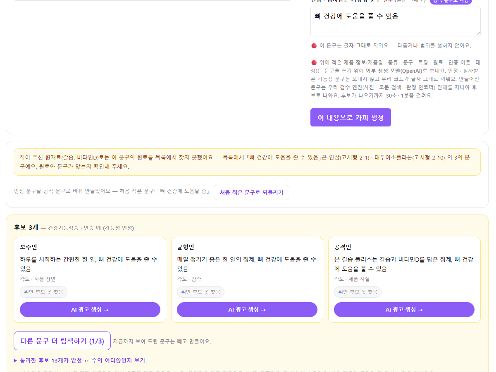

# 카피 생성 「인정 · 심사받은 기능성 문구」 — 경고(①) · 공식 문구 대조(②) 도입 효과 비교

> 작성 2026-10-15 · 권소라(ksr) · 관련 결정 **D-341**(결정 1 경고 · 결정 4 인정 문구 대조 · 상태 줄 「약한 경고 문안 검토(화면 담당)」)
> 화면 캡처 폴더 `인정문구_경고대조_효과비교_ksr_2026-10-15/` · 그 전 캡처 `인정문구대조_화면_ksr_2026-10-15/`

| 표기 | 무엇 | 만든 사람 · 코드 |
|---|---|---|
| **기존** | 인정 문구를 아무것도 검사하지 않음 | — |
| **①** 경고 | 인정 문구만 그 전제(건기식 인정 · 화장품)로 **따로 판정** — 질병 · 의약품 표현이면 강한(사전) · 약한(AI 추정) 경고 · 떨구지 않음 | 팀장 · `user._fixed_notes` · `reasons.FIXED_*` |
| **②** 공식 문구 대조 | 인정 문구를 **식약처 인정 · 고시 문구 목록과 글자로 대조** — 같음 · 비슷함(바꾼 점) · 다른 원료 · 목록에 없음 | ksr · `app/claim_match.py` · `user._fixed_match_notes` · `reasons.MATCH_*` |
| **①+②** | 둘을 화면에 내기 직전에 **섞음** — 약한 경고 문안을 ②의 결과로 고름 | ksr · `user._fixed_all_notes` |

---

## 1. 기존 — 결과값과 문제점

카피 생성에서 「건강기능식품 · 인증 예」(또는 「화장품 · 인증 예」)를 고르면 이용자가 **인정 · 심사받은 문구를 직접 입력**한다. 이 문구는

- 생성 판정에서 **빠진 채** 후보 카피에 **글자 그대로** 들어가고(`copygen` 자리표시자)
- AI 광고 생성으로 넘어가도 판정에서 빼고 「확인 필요」만 단다(`_judged_part`).

| 문제 | 예 | 결과 |
|---|---|---|
| 인정을 받아도 쓸 수 없는 표현 | 「관절염을 치료합니다」 · 「면역력 증진 및 암 예방에 도움」 | 그대로 광고에 실림 |
| 공식 문구를 바꿔 씀(단정 · 강조 · 한정 삭제) | 「뼈 건강에 도움을 **줌**」(공식: 「…줄 수 **있음**」) | 그대로 실림 |
| 지어낸 문구 | 「간을 해독해 줍니다」 | 그대로 실림 |
| 다른 원료의 인정 문구 | 칼슘 제품에 「뼈 건강에 도움을 줄 수 있음」(인삼 · 대두이소플라본의 문구) | 그대로 실림 |

**기존 결과값 — 어떤 입력에도 안내 0 건**(아래 표의 「기존」 열).

---

## 2. 변경 방법

### ① 경고만 (팀장 · D-341 결정 1)
- 인정 문구 하나를 **그 분기의 판정 전제**로 판정 → 질병_예방치료_표방 · 의약품_오인이 사전에 걸리면 **강한 경고**, AI(인코더)만 추정하면 **약한 경고**.
- 거짓_과장 · 건강기능식품_오인은 경고하지 않음(진짜 인정 문구에 늘 걸려서).
- **문구가 공식 문구인지는 보지 않음.** 약한 경고 문안은 늘 「『질병 발생 위험 감소』로 인정받은 문구라면 정상이에요」.

### ② 공식 문구 대조만 (ksr · D-341 결정 4)
- 목록(정본만) — 고시형 `hf_gosi_claims.jsonl`(「건강기능식품의 기준 및 규격」 고시전문에서 새로 뽑음 · 원료 93 · 문구 169) + 개별인정형 `hf_api_labels.jsonl` · `mfds_hf_labels.jsonl` → 공식 문구 219 개.
  - ⛔ D-341 결정 4 에 적힌 `hf_display_claims.jsonl` 은 쓰지 않았다 — I-0040 **업체 신고 표시 문구**(관측 축 · 정본과 같음 65 %)라 정본이 아니다.
- 결과 넷 — **같음**(원료 이름 표시) · **비슷함**(바꾼 점: 단정형 · 강조어 · 대상 · 조건 빠짐 · 덧붙임 + 공식 문구 원문) · **다른 원료**(원재료 칸과 원료가 안 맞음) · **목록에 없음**. 화장품은 목록이 없어 「확인 못 함」.
- 비슷함이면 **「공식 문구로 다시 만들기」** 버튼(누를 때만 다시 생성 · GPT 1 회) · 다시 만든 뒤 **「처음 적은 문구로 되돌리기」**.

### ①+② 섞기 (ksr · D-341 「약한 경고 문안 검토」)
| 경우 | 화면 |
|---|---|
| 약한 경고 + 공식 문구와 같음 | 약한 경고를 뺀다(공식 문구임을 글자로 확인) |
| 약한 경고 + 비슷함 · 목록에 없음 | 「AI 가 질병 · 의약품 관련 표현으로 추정했고, 식약처 인정 · 고시 문구 목록에도 없는 문구예요 — 인정을 받아도 쓸 수 없는 표현일 수 있어요」 |
| 약한 경고 + 화장품 | 「…기능성화장품 심사를 받은 문구라면 정상일 수 있어요(목록이 없어 대조하지 못했어요)」 |
| 강한 경고 · 확인 못 함 | 그대로(D-341 결정 1) + 대조 안내를 뒤에 붙임 |

`_fixed_notes`(팀장 함수 · 측정)는 고치지 않았다.

---

## 3. 효과 — 수치 (2026-10-15 · 이 PC · 실제 판정 엔진)

「안내」 = 화면에 경고 또는 대조 안내(같음 제외)가 하나라도 뜬 것. 정상 집합에서는 **잘못된 안내**, 위반 집합에서는 **잡은 것**이다.

| 집합 | n | 기존 | ① 경고만 | ② 대조만 | ①+② |
|---|--:|--:|--:|--:|--:|
| 정상 · 공식 문구(원재료 없음) | 219 | 0 | 4 (2%) | 0 (0%) | **0 (0%)** |
| 정상 · 공식 문구 + 맞는 원재료 | 219 | 0 | 4 (2%) | 0 (0%) | **0 (0%)** |
| 위반 · 질병 표현(사전에 있는 병) | 40 | 0 | 39 (98%) | 40 (100%) | 40 (100%) |
| 위반 · 질병 표현(**사전에 없는 병** — 관절염 등) | 60 | 0 | 32 (53%) | 60 (100%) | 60 (100%) |
| 위반 · 의약품 표현 | 15 | 0 | 11 (73%) | 15 (100%) | 15 (100%) |
| 위반 · 공식 문구를 바꾼 것(단정 · 강조 · 질병 덧붙임) | 106 | 0 | 2 (2%) | 106 (100%) | 106 (100%) |
| 위반 · 지어낸 문구 | 20 | 0 | 3 (15%) | 20 (100%) | 20 (100%) |
| 위반 · 다른 원료의 공식 문구 | 50 | 0 | 1 (2%) | 50 (100%) | 50 (100%) |
| **정상 합계** | 438 | 0 | 8 (2%) | 0 (0%) | **0 (0%)** |
| **위반 합계** | 291 | 0 | 88 (30%) | 291 (100%) | **291 (100%)** |

- 강한 경고(① 중 사전 근거) — 사전에 있는 병 35/40 · **사전에 없는 병 2/60** · 의약품 7/15 · 지어낸 문구 1/20.
- **②와 ①+②의 「잡은 수」는 같다.** 차이는 **안내의 내용**이다 — ②만이면 「목록에 없어요」만 말하고 위험의 종류(질병 · 의약품)를 모른다. ①만이면 약한 경고가 치료 표현에 「정상일 수 있다」고 말한다. ①+②는 진짜 공식 문구에서 약한 경고를 걷고(오경보 8 → 0), 질병 · 의약품 추정이 있을 때 「정상일 수 있다」 대신 「쓸 수 없는 표현일 수 있다」고 말한다.

### 수치를 읽는 법 (한계)
- **100 % 는 「안내가 뜬다」이지 「막는다」가 아니다.** 지금은 아무것도 막지 않는다(D-341 결정 1 · 막을지는 측정 뒤 ⬜).
- ②는 목록에 없으면 모두 「목록에 없음」을 띄우게 설계돼 있어 위반을 잡는 비율이 **구조상 높다.** 반대로 **진짜 인정 문구인데 우리 목록에 없으면** 그것도 「목록에 없음」이 뜬다 — 정상 집합(우리 목록 그대로)은 이것을 재지 못한다. 앞선 측정에서 업체가 실제로 신고한 문구 중 목록에 짝이 없는 276 건의 29 건이 「목록에 없음」이었다.
- 위반 집합은 ksr 가 만든 문장 · 일부는 n < 30 — 경향만 본다(D-40).
- 「막기」를 검토한다면 근거는 **사전에 없는 병의 강한 경고 3 %** 다 — 강한 경고로만 막으면 관절염 · 지방간 같은 표현은 대부분 지난다(D-341 측정의 「관절염」 사전 빈칸과 같은 이야기 · D-313 몫).
- 기능성화장품은 목록이 없어 ②가 「확인 못 함」이다. 화장품 「아토피 피부염을 치료하는 크림」에는 ①도 경고를 내지 않았다(엔진 몫 · 보고만).

---

## 4. 화면 — 같은 입력을 네 상태로 (전 · 후)

각 그림은 위에서부터 **기존 → ① 경고만 → ② 대조만 → ①+② 섞은 뒤(지금)** 이다. 입력 칸 아래 노란 · 초록 상자가 안내다.
(캡처는 생성 엔진을 부르지 않고 안내만 보이게 찍었다 — 후보 카피는 어느 상태에서나 같다.)

### A. 공식 문구를 바꿔 씀 — 「뼈 건강에 도움을 줌」 · 원재료 칼슘
- 기존 · ① — 안내 없음(①은 질병 · 의약품만 본다).
- ② · ①+② — 「공식 문구의 『줄 수 있음』이 단정하는 말로 바뀌어 있어요 · 공식 문구: 『뼈 건강에 도움을 줄 수 있음』」 + **공식 문구로 다시 만들기** 버튼.

### B. 사전에 없는 질병 — 「관절염을 치료합니다」
- ① — 약한 경고 「…『질병 발생 위험 감소』로 인정받은 문구라면 **정상이에요**」 ← 치료 표현에 어긋남(팀장 지적).
- ② — 「목록에서 찾지 못했어요」(위험 종류는 모름).
- ①+② — 「AI 가 질병 · 의약품 관련 표현으로 추정했고, 공식 문구 목록에도 없어요 — **인정을 받아도 쓸 수 없는 표현일 수 있어요**」.

### C. 진짜 공식 문구 — 「골다공증 발생 위험 감소에 도움을 줌」 · 원재료 칼슘
- ① — 약한 경고(정상 문구에 뜬 **오경보**).
- ② · ①+② — 「식약처 인정 · 고시 문구와 같아요 — 칼슘(고시형 1-15) · 비타민 D(고시형 1-3)」만(초록).

### D. 화장품 — 「피부의 미백에 도움을 준다」
- ① — 약한 경고 「질병 발생 위험 감소…」(건강기능식품 문안이 화장품에).
- ② — 「기능성화장품 심사 문구는 대조할 목록이 아직 없어요」.
- ①+② — 「AI 가 의약품 관련 표현으로 추정했어요 — **기능성화장품 심사를 받은 문구라면 정상일 수 있어요**(목록이 없어 대조하지 못했어요)」 한 줄.

### (참고) 「공식 문구로 다시 만들기」 버튼 — 실제 생성
- 누르기 전 — 후보에 「…도움을 줌」 그대로 · 누른 뒤 — 인정 문구 칸이 공식 문구로 바뀌고(「공식 문구로 바뀜」) 새 후보 3 개 모두 「…도움을 줄 수 있음」. 칼슘 제품이라 「다른 원료」 안내는 계속 뜬다(자동으로 바꾸지 않는 이유).

---

## 5. 남은 것 · 확인 요청

| 항목 | 누구 |
|---|---|
| D-341 결정 4 의 재료를 `hf_display_claims` → 정본(개별인정형) + 고시형으로 바꾼 것 확인 | 팀장 |
| 강한 경고를 「생성 중단」으로 올릴지 — 사전에 없는 병 강한 경고 3 % 를 함께 볼 것 | 팀장(D-341 ⬜) |
| 사전에 「관절염」 등 질병 항목 보강(D-313) | 사전 담당 |
| 기능성화장품 심사 문구 목록(「기능성화장품 기준 및 시험방법」 고시) | 데이터 |
| 고시형 원본 ZIP raw-publish · 파생물 원장 기록 — 다른 PC 에는 목록 파일이 없어 「확인 못 함」이 뜬다 | 정본 PC |

### 재현
- 고시형 목록 — `python -m preprocess.hf_gosi --dump`(원본 `data/raw/law/admrul_34650_20260611_attach.zip`)
- 테스트 — `tests/test_claim_match.py`(작은 목록을 임시로 만든다)
- 측정 — 이 문서의 수치는 실제 엔진으로 `_fixed_notes` · `_fixed_match_notes` · `_fixed_all_notes` 를 문장마다 불러 셌다(측정 스크립트는 저장소 밖 · 게이트 아님).
