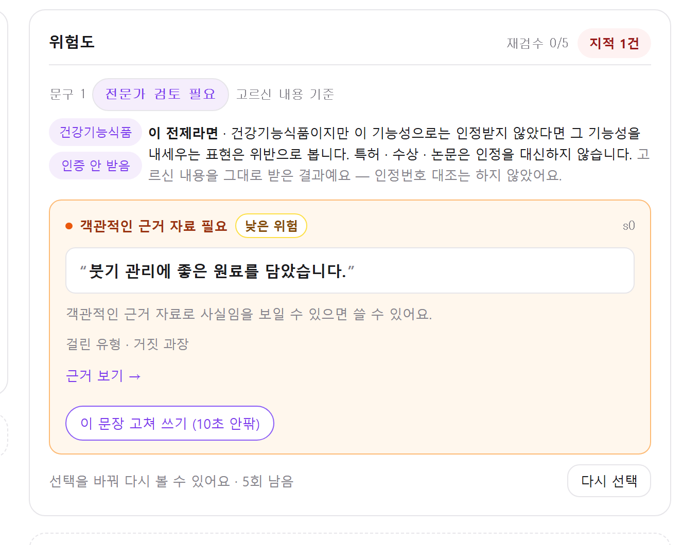

# 질문 — 「인증 안 받음」을 골랐는데 「객관적인 근거 자료 필요」가 나와요 (2026-10-13)

- **작성**: ksr (화면 담당) · 2026-10-13
- **받는 사람**: 팀장 · 판정 코어 담당(ohb)
- **한 줄**: 건강기능식품 · 인증 안 받음 전제에서 「붓기 관리에 좋은 원료를 담았습니다.」가 **실증형(B)** 으로 나옵니다. 이 결과가 의도한 것인지 묻습니다.
- 화면은 엔진이 보낸 값을 그대로 그리고 있습니다. 화면에서 바꾸지 않았습니다.

---

## 1. 무엇이 이상해 보이나

이용자가 **건강기능식품 → 인증 안 받음**을 고른 화면입니다. 세 자리가 서로 다른 말을 합니다.

| 자리 | 화면의 말 | 읽히는 뜻 |
|---|---|---|
| 전제 문안 | 이 기능성으로는 인정받지 않았다면 그 기능성을 내세우는 표현은 **위반으로 봅니다** | 쓸 수 없다 |
| 문장 카드 | **객관적인 근거 자료 필요** — 근거 자료로 사실임을 보일 수 있으면 쓸 수 있어요 | 조건이 맞으면 쓸 수 있다 |
| 문구 배지 | **전문가 검토 필요** | 확정하지 못했다 |

## 2. 엔진이 낸 값

- 방법: `POST /judge` 에 문장 하나 (`fastapi.testclient` · 이 PC · 2026-10-13)
- 판정 버전: `rule-0.3.0-dict+enc:b1205ce5484d`
- 문장: 「붓기 관리에 좋은 원료를 담았습니다.」

| 전제(분기) | 분기 결과 | 문장 판정 | 유형 | 사유 | 위험도 |
|---|---|---|---|---|---|
| 기록되는 판정 | 보류 | 보류 · 품목 선택 필요 | 거짓_과장 | B | R1 |
| 식품 | 보류 | 확정 | 거짓_과장 | B | R1 (상한 R2) |
| 일반식품 기능성 | 보류 | 확정 | 거짓_과장 | B | R1 (상한 R2) |
| 건강기능식품 · 인정 | 보류 | 확정 | 거짓_과장 | B | R1 (상한 R2) |
| **건강기능식품 · 비인정** | **보류** | **확정** | **거짓_과장** | **B** | **R1 (상한 R2)** |
| 화장품 · 일반상품 | 보류 | 보류 · 확신 부족 | — | — | — |

- 식품 계열 네 전제의 결과가 **전부 같습니다.** 인증을 받았든 안 받았든 실증형(B)입니다.
- 인용 근거는 식품표시광고법 제8조 제1항 제4호 하나입니다.
- 사전 항목: `붓기` — 유형 거짓_과장 · 근거 제8조제1항제4호 · 출처 `mfds_casebook` · 단독판정 가능.
- 인코더 추정: 거짓_과장 0.46.

## 3. 비교 — 같은 전제에서 자격형(A)으로 바뀌는 문장

10-12 에 본 「면역력 강화에 도움을 줍니다.」는 같은 건강기능식품 · 비인정 전제에서 **거짓_과장 · 사유 A** 로 나왔습니다 — 인정받지 않은 기능성으로 바꾸는 규칙(`app/graph.py` `converted` · `app/reasons.py` 「건강기능식품이라도 인정받지 않은 기능성은 내세울 수 없습니다」 · D-319)을 탔기 때문으로 보입니다.

「붓기 관리에 좋은」은 그 규칙을 타지 않았습니다.

## 4. 묻고 싶은 것

1. **「붓기 관리에 좋은 원료」는 기능성을 내세우는 표현으로 봐야 하나요?** 그렇다면 비인정 전제에서는 자격형(A)이 되어야 할 것 같은데, 지금은 실증형(B)입니다. 일반 거짓 · 과장으로 두는 것이 의도라면 그 이유를 알려 주세요.
2. **건강기능식품 · 인정 전제에서도 같은 B 가 맞나요?** 인정받은 기능성이 「붓기」와 무관한 경우를 뜻하는 것인지 확인하고 싶습니다.
3. **분기 결과가 「보류」인데 그 안의 문장은 「확정」입니다.** 문구 배지는 분기 결과(「전문가 검토 필요」)로, 문장 카드는 문장 판정으로 그리다 보니 한 화면에서 말이 갈립니다. 확정된 B 문장만 있는 분기가 「지시」(`guidance`)가 아니라 보류로 오는 것이 의도인가요?

## 5. 답에 따라 화면이 할 일

- 1 · 2 번이 "엔진을 고친다"면 화면은 그대로 둡니다 — 값이 바뀌면 카드가 따라 바뀝니다.
- 1 번이 "의도한 결과다"라면, 비인정 전제의 전제 문안과 실증형 카드가 함께 설 때 덧붙일 설명 문구를 정해 주세요. 화면이 사유를 바꿔 그리지는 않겠습니다.
- 3 번이 "의도한 결과다"라면, 배지와 카드 중 어느 쪽을 기준으로 보일지 정해 주세요.

## 6. 확인하지 않은 것

- 「붓기」 계열 다른 사전 항목(`다리붓기` · `붓기제거` · `붓기차`)의 결과 — 모두 같은 유형 · 근거로 실려 있습니다.
- 분기 결과가 보류로 정해지는 엔진 코드의 조건.
- 비슷한 표현이 얼마나 더 있는지 — 이 문장 하나만 돌렸습니다.
