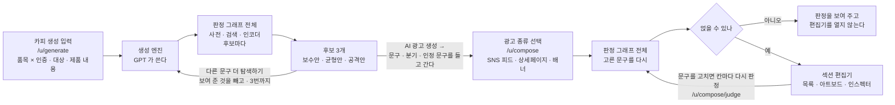
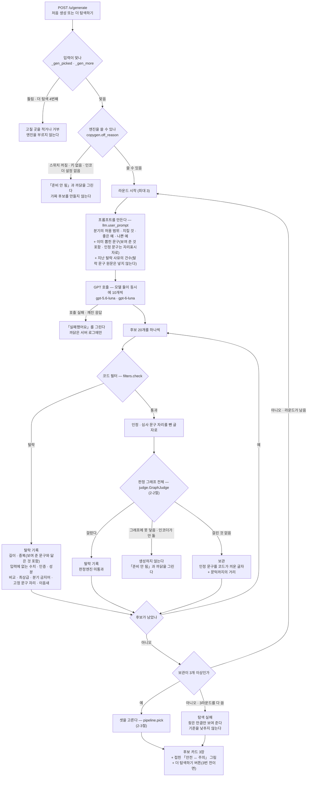
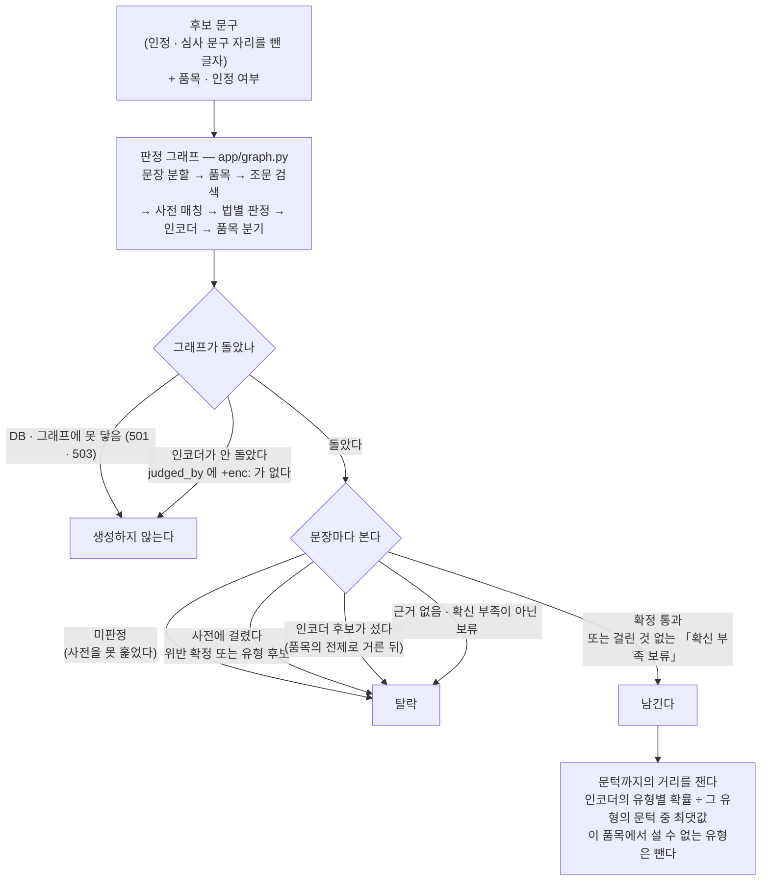
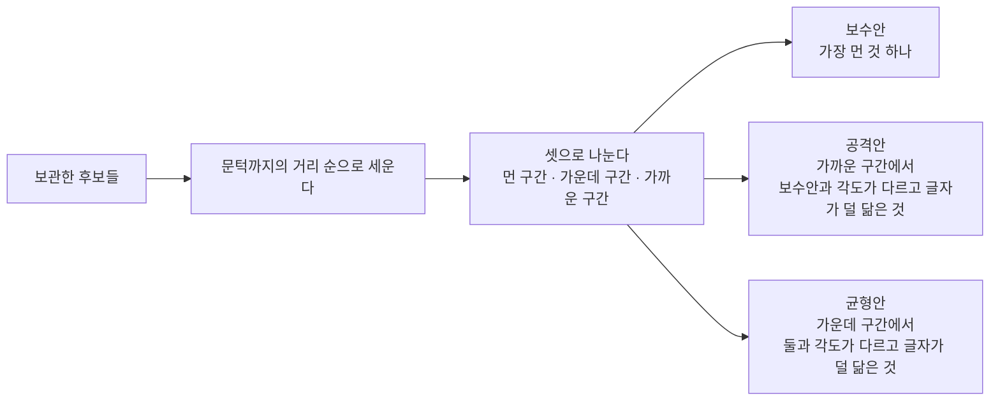

# 카피 생성 엔진 연결 · AI 광고 생성 편집기 — 변경 기록 (2026-10-12 ~ 10-13)

- 작성: 권소라(ksr) · 정리 보조: Claude Code
- 범위: 사용자 화면 `/u/generate`(카피 생성) · `/u/compose`(AI 광고 생성)
- 한 줄 요약: **GPT 가 문구를 쓰고, 그 문구가 판정 그래프 전체(사전 · 조문 검색 · 인코더)를 지나야 후보가 된다.
  고른 후보는 3종 광고 편집기로 넘어가 초안이 된다.**
  저장 · 공유 · 다운로드는 없다. 코어 `/generate` · `/compose` 는 여전히 501 이다.

**읽을 때**

- 🚨 화면의 「위반 후보 못 찾음」은 **판정 그래프(사전 · 인코더)가 걸린 것을 찾지 못했다**는 뜻이다. 적법 확인이 아니다.
- 🚨 GPT API 를 생성 경로에서 부른다. D-78 ② 와 다르다 — 10-13 에 팀장과 협의해 **생성에만** 붙이기로 했다. 판정에는 넣지 않는다.
  결정 원장의 개정은 팀장 몫이다(이 문서는 원장을 고치지 않았다).
- 아래 4절 「미구현」이 이 문서의 절반이다. 화면이 돈다고 해서 그 절의 항목이 된 것이 아니다.

**10-13 하루 동안 바뀐 순서** (아래 본문은 마지막 상태다)

| 때 | 바뀐 것 |
|---|---|
| 오전 | 엔진 연결 — GPT 생성 → 코드 필터 → **인코더만** 판정 → 서로 가장 다른 3개 |
| 오전 | 인코더를 카드 17 판으로(이 PC) · 후보 3개를 **보수안 · 균형안 · 공격안**으로 · 화면에서 「문턱」이라는 말과 수치를 뺐다 |
| 오후 | **더 탐색하기**(3번까지) · **생성 중 표시** · 인정 문구가 2라운드에 밖으로 나가던 것을 고쳤다 |
| 오후 | 판정을 인코더만에서 **판정 그래프 전체**로(권소라 — 「사전이 들어가야 한다」 · 「판정 그래프 전체를 통과해야 한다」) |

---

## 1. 전체 흐름

판정은 **어디서나 같은 판정 그래프**다(`app.api.judge` · `POST /judge` 와 같은 함수 · D-119).
생성 단계에서는 후보마다, 광고 생성 단계에서는 고른 문구와 고친 문구마다 돈다.

---

## 2. 생성 엔진이 도는 길

`POST /u/generate` 한 번이 아래를 끝까지 돈다. 실측 25 ~ 50초(10-13 · 이 PC).

### 2-1. 요청 하나의 길

### 2-2. 판정 그래프 전체 — 후보 하나가 지나는 길

후보 하나를 `app.api.judge` 에 넣는다. 분기에서 고른 **품목과 인정 여부**를 같이 넘긴다. 후보 하나에 약 0.5초.

- 🚨 **「통과」가 아니라 「걸린 것 없음」을 남긴다.** 판정 그래프 1판은 사전이 침묵한 문장에 통과를 내지 않고 **보류(확신 부족)** 를 낸다(D-269).
  종착이 `pass` 인 것만 남기면 후보가 하나도 나오지 않는다. 광고 생성의 `_lands` 와 같은 기준이다(3절).
- 🚨 그래프에 못 닿거나 인코더가 안 돌았으면 **후보를 만들지 않는다** — 사전만 지난 것을 다 지난 것처럼 내지 않는다(D-147).
- 인코더 후보를 품목의 전제로 거르는 것은 그래프의 일이다(D-323 결정 6 · 건강기능식품 전제에서 「건강기능식품 오인」이 서지 않는다).
- 「문턱까지의 거리」는 인코더 확률에서 따로 잰다 — 그래프의 응답에는 문턱을 넘은 후보만 실리기 때문이다. 위험도 등급(R0 ~ R4)이 아니다.

### 2-3. 셋을 고르는 길 — 보수안 · 균형안 · 공격안

- 구간 안에 각도가 다른 후보가 없으면 **구간(거리 간격)을 지키고 닮은 정도를 양보한다.**
- 셋을 못 채우면 이름을 붙이지 않는다 — 둘을 놓고 「보수 · 공격」이라 부르지 않는다.
- 🚨 「공격안」도 걸린 것이 없는 후보다. 더 센 문구라는 보증이 아니다.
- 이용자 화면에는 **「문턱」이라는 말과 수치를 적지 않는다**(10-13 권소라). 카드에는 이름 · 문구 · 각도 · 「위반 후보 못 찾음」만 있고,
  접힌 그림의 축은 「안전 ↔ 주의」다. 수치는 코드(`Kept.closeness` · `top`)에만 있다.

### 2-4. 단계별로 무엇이 막는가

| 단계 | 어디 | 막는 것 | 못 막는 것 |
|---|---|---|---|
| 프롬프트 | `copygen/llm.py` · `branches.py` | 분기 밖 표현을 쓰지 않게 **요청** | 모델이 요청을 어기는 것 |
| 코드 필터 | `copygen/filters.py` | 입력에 없는 **수치 · 인증 · 성분**, 최상급, 분기 금지어, 중복, 고정 문구 자리 | 말로 풀어 쓴 새 주장(낱말 목록에 안 걸리는 것) |
| 판정 그래프 | `copygen/judge.py` `GraphJudge` → `app/api.judge` | **사전**(위반 확정 · 유형 후보)과 **인코더**의 위반 유형 9종(문턱은 모델 폴더의 `label_scheme.json`) · 인코더 후보는 품목의 전제로 거른다 | 사전에 없고 인코더도 모르는 표현 |
| 셋 고르기 | `copygen/pipeline.py` `pick` | 서로 닮은 셋이 나오는 것 | 남은 후보가 3 ~ 4개뿐일 때의 겹침 |

### 2-5. 더 탐색하기 · 생성 중 표시

- **더 탐색하기** — 후보 아래의 「다른 문구 더 탐색하기 (n/3)」. **지금까지 보여 준 문구를 빼고** 다시 만든다. **세 번까지**다(권소라 결정).
  - 보여 준 문구는 폼이 들고 간다(서버에 남기지 않는다). 그것과 80% 이상 닮은 후보는 중복으로 떨어지고,
    생성 모델에는 「이미 뽑힌 문구」로 알려 다른 각도 · 표현을 쓰게 한다.
  - 🚨 횟수는 화면의 약속이지 비용의 방벽이 아니다 — 새로 「카피 생성」을 누르면 처음부터다(4-2절 10번).
- **생성 중 표시** — 제출하면 버튼 위에 가운뎃점 넷과 「문구 생성 중입니다」가 뜨고 버튼이 잠긴다(`user_wait.js`). 스크립트가 안 돌아도 생성은 된다.

### 2-6. 밖으로 나가는 것

| | 내용 |
|---|---|
| OpenAI 로 **나간다** | 이용자가 적은 제품 정보 — 제품명 · 종류 · 간단한 문구 · 특징 · 원료 · 인증 이름 · 대상. 2라운드 · 더 탐색하기에서는 **앞서 뽑힌 문구**도 간다(인정 문구는 자리표시자로) |
| **나가지 않는다** | 인정 · 심사받은 기능성 문구(코드가 `{{고정문구}}` 자리에 끼운다) · 탈락 문구 원문 · 검수 문구 · 판정 결과 |
| 화면 고지 | 엔진이 켜진 환경에서만 입력 칸 아래에 적는다 |
| 로그 | 건수 · 토큰 수만 남긴다. 이용자 입력 · 생성 문구 · 탈락 문구 원문은 남기지 않는다 |

- 🔴 10-13 오후에 고친 것 — 「이미 뽑힌 문구」가 인정 문구를 **끼운 뒤**의 글자였다(시험 코드에서 넘어온 동작). 2라운드부터 인정 문구가 밖으로 나갔다.
  끼우기 전의 글자(`Kept.raw`)만 보내도록 고쳤고 테스트가 지킨다. 그 전의 커밋(`15c97b1`)에는 이 문제가 있다.

### 2-7. 켜는 법 (기기별 `.env`)

| 변수 | 값 | 뜻 |
|---|---|---|
| `COPYLANE_COPYGEN` | `gpt` | 이 값일 때만 GPT 를 부른다. 비었으면 꺼짐 — 키가 있어도 부르지 않는다 |
| `OPENAI_API_KEY` | (키) | `launcher.py setkey` 로 넣는다 |
| `COPYLANE_MODEL_DIR` | 모델 폴더 | 판정 인코더. **검수 화면과 같은 변수**다 — 판정 그래프가 하나이므로 바꾸면 검수 · 생성 · 광고 생성이 같이 바뀐다 |
| `COPYLANE_COPYGEN_MODEL` | (선택) | 생성 모델. 쉼표로 이으면 섞는다. 기본 `gpt-5.6-luna,gpt-6-luna` |

- 판정 그래프가 돌아야 하므로 **DB 가 떠 있어야 한다**(마이그레이션 0025 · 적재 · 임베딩).
- 인코더는 폴더만 바꿔 끼울 수 있다 — `models/` 에 새 폴더를 두고 `COPYLANE_MODEL_DIR` 을 바꾼 뒤 서버를 다시 띄운다.
  폴더 구성(`model.safetensors` · `label_scheme.json` · `config.json` · 토크나이저 둘)과 위반 유형 9종의 이름이 같아야 한다.
- 테스트는 `tests/conftest.py` 가 스위치를 꺼 둔다 — 테스트가 밖을 부르지 않는다.

### 2-8. 실측 (10-13 · 이 PC · 입력 하나를 한 번씩 — 비교 실험이 아니다)

**지금 판(판정 그래프 전체 · 인코더 카드 17)**

| 분기 | 걸린 시간 | 만든 것 | 남긴 것 | 판정 탈락 | 그 밖의 탈락 |
|---|---|--:|--:|--:|--:|
| 화장품 · 인증 아니오 | 51초 (첫 호출 · 모델 올리기 포함) | 20 | 13 | 6 (전부 인코더 후보 · 거짓 · 과장) | 중복 1 |
| 건강기능식품 · 인증 예 | 25초 | 20 | 19 | 0 | 중복 1 |
| 화장품 · 인증 아니오 (화면에서) | 약 40초 | 20 | 15 | 3 | 중복 2 |

- 이 세 번에서 **사전 적중으로 떨어진 후보는 없었다** — 금지 낱말은 코드 필터가 먼저 거른다. 필터를 빠져나간 표현이 사전에 있으면 그래프에서 걸린다(테스트가 본다).
- 그래프 판정이 후보 하나에 약 0.5초다. 인코더만 볼 때보다 한 라운드에 10초쯤 더 걸린다.

**참고 — 오전 판(인코더만)에서 모델에 따라 갈린 정도** (화장품 · 인증 아니오 · 같은 입력)

| | `v10-합성O-이유O` | `v10-카드17-검수정상음성` |
|---|---|---|
| 걸린 시간 | 35초 (2라운드) | 20초 (1라운드) |
| 만든 후보 | 40 | 20 |
| 남긴 것 | 3 | 16 |
| 인코더 탈락 | 36 (대부분 거짓 · 과장 · 문턱 0.375) | 2 (비방광고 · 문턱 0.3) |

- 10-13 부터 이 PC 는 카드 17 판을 쓴다(권소라 지정 · 「일단 이걸로」). ohb 브랜치에 **D-331(카드 17 을 배포 인코더로 채택)** 이 있다 — main 에 들어오면 정식이다.

---

## 3. AI 광고 생성 편집기

프로토타입 v7.2 `draft-setup` · `draft-editor` 에서 **3종만** 옮겼다.

| 종류 | 규격 | 섹션 |
|---|---|---|
| SNS 피드 | 1080 × 1080 | 비주얼 · 캡션 · 고지 |
| 배너 | 300 × 250 | 비주얼 · 캡션 · 고지 |
| 상세페이지 | 860 × 세로 가변 | 후킹 · 핵심 소구점 3분할 · 물품 설명 · 성분 · 함량 · 필수 표기(고정) |

**되는 것**

- 섹션 목록 — 선택 · 위아래 이동 · 삭제 · 추가. 필수 표기는 맨 아래에 고정이고 지울 수 없다
- 아트보드 — 실제 규격 미리보기 · 확대/축소(30 ~ 100%)
- 인스펙터 — 문구 수정 → 칸별 판정 · 이미지 올리기(브라우저 안에만) · 대체 텍스트
- 초안 검수 — 판정 대기 · 보류 · 확인 필요 · 빈 이미지 · 대체 텍스트 누락 · 잘린 문구를 한 줄로 센다
- 「광고」 표시와 필수 병기 문구는 구조로 들어간다(D-93 · D-164)

**문구가 지면에 얹히는 규칙** (`app/routers/user.py` `_lands` 한 곳)

| 판정 | 처리 |
|---|---|
| 확정 · R0 | 얹는다 |
| 보류(확신 부족) · 유형 후보 없음 | **「확인 필요」를 달고 얹는다** |
| 보류 · 유형 후보 있음 / 위반 확정 / 근거 없음 / 미판정 | 얹지 않는다 |

- 🚨 둘째 줄은 D-63(「확정이 아니면 얹지 않는다」)을 **느슨하게 한 것**이다. 검수 엔진 1판은 사전이 침묵하면 통과가 아니라 보류를 낸다(D-269) —
  그대로 걸면 어떤 문구도 편집기에 못 들어간다. 10-12 권소라 결정. 엄격하게 되돌리려면 `_lands` 의 그 가지를 `ng` 로 바꾼다.
- 고친 문구는 칸의 「판정」을 눌러 통과해야 아트보드에 반영된다. 그 전에는 앞서 통과한 문구가 남는다.

**카피 생성에서 넘어올 때** (10-13)

- 문구 · 필수 병기 문구 · **분기** · **인정 · 심사 문구**가 같이 넘어온다.
- 광고 생성의 판정은 그 분기의 품목으로 돌고, 인정 · 심사 문구는 판정에서 뺀다(생성 단계와 같은 규칙).
  빼지 않으면 인정 문구(「…도움을 줄 수 있음」)가 유형 후보로 걸려 인정 제품의 후보가 전부 막힌다(10-13 화면에서 재현).
- 🚨 인정 문구는 **이용자가 적은 값이고 확인되지 않았다.** 화면이 그렇게 적는다. 인정 문구가 필요 없는 분기에서는 읽지 않는다.

---

## 4. 미구현 · 알려진 한계

### 4-1. AI 광고 생성 (편집기)

| # | 항목 | 지금 상태 |
|:-:|---|---|
| 1 | **저장 · 임시저장 · 자동 저장** | 없다. 화면을 새로 고치면 편집한 내용이 사라진다. 초안을 담을 DB 표가 없다 |
| 2 | **다운로드**(PNG · JPG · PDF · HTML) | 없다. 만든 광고를 밖으로 꺼낼 방법이 없다 |
| 3 | **공유** · 팀원 지정 · 링크 | 없다 |
| 4 | 이어서 작업하기 · 문서 제목 · 초기화 버튼 | 없다(프로토타입 v6.7 ~ v6.8 기능) |
| 5 | **이미지 생성** | 없다. 이용자가 올린 파일을 브라우저 안에서만 보여 준다. 서버에 올라가지 않는다(업로드는 `python-multipart` — 새 의존성 · D-87) |
| 6 | **섹션 문구를 AI 가 써 주는 것** | 없다. 넘어온 문구와 필수 병기 문구만 얹고 나머지 칸은 빈칸이다. 프로토타입의 예시 문장 · 함량표는 옮기지 않았다(지어낸 값 · D-147) |
| 7 | 적은 내용에 따라 섹션 구성이 달라지는 것 | 없다. 종류마다 섹션이 고정이다(프로토타입 `promptToTypes` · 프롬프트 칩) |
| 8 | 빠진 광고 종류 | 쇼츠 · 블로그 작성 · 리더보드 배너(728 × 90) · 빌보드 배너(970 × 250) |
| 9 | 빠진 상세페이지 섹션 | 공감 · 문제제기 / 섭취 · 사용법 / 고객 후기 / 배송 · 교환 · 환불 |
| 10 | 성분 · 함량의 **사실 원장 주입** | 없다. 이용자가 「이름: 값」으로 직접 적는다. 값의 진위를 대조하지 않는다 |
| 11 | 코어 `POST /compose` · 계약 `ComposeResponse` | 501 그대로다. 섹션 골격은 화면 스크립트(`user_compose.js`)가 깐다. 서버 계약을 지나지 않는다 |
| 12 | 계약 `AdFormat` 과의 불일치 | 계약은 상세페이지 · 카드뉴스 · 배너, 화면은 SNS 피드 · 상세페이지 · 배너다. 계약 · 픽스처는 고치지 않았다 |
| 13 | 채널별 각색(`AdaptedCopy` · `source_copy` 경로) | 없다. 넘어온 문구는 직접 입력(`prompt`)과 같은 길로 다시 판정한다 |
| 14 | 판정의 「통과」 | 검수 엔진이 통과를 내지 않아 대부분 「확인 필요」로 얹힌다(위 3절). 사전에 없는 위반 표현은 걸리지 않는다 |
| 15 | 인정 · 심사 문구의 검증 | 없다. 이용자가 적은 글자를 그대로 믿고 판정에서 뺀다. 인정번호 대조가 없다(D-263 ⑥) |
| 16 | 긴 문구의 잘림 | SNS · 배너 비주얼은 헤드라인 3줄 · 보조 2줄에서 자른다. **인정 문구가 든 긴 후보가 비주얼에서 잘린다** — 초안 검수가 「잘린 문구」로 세어 주기만 한다 |
| 17 | 좁은 화면 | 세 칸이 세로로 쌓인다. 아트보드 안에 가로 스크롤이 조금 남는다 |
| 18 | 섹션을 끌어 옮기기 | 없다. 위 · 아래 버튼으로 옮긴다 |
| 19 | 판정 이력 저장 | 없다. 광고 생성의 판정은 `judgment` 표에 남지 않는다 |
| 20 | 산문 좌표 옆 문서 이름(`doc_title`) | 판정 근거에 조 이름만 찍는다(인계 10-13 §1 안건 3) |

### 4-2. 카피 생성 (엔진)

| # | 항목 | 지금 상태 |
|:-:|---|---|
| 1 | ~~「더 탐색하기」~~ | ✅ 10-13 에 붙였다 — 2-5절. 남은 것: 횟수(3번)를 폼이 들고 다녀 서버가 강제하지 못한다(로그인 · 저장이 없다) |
| 2 | **잔여 리스크(R0 ~ R4) · 소구력 보존** | 재지 않는다. 계약 `GenerateResponse` · `Candidate` 를 채우지 않는다. 화면의 보수 · 균형 · 공격은 **인코더의 문턱까지 거리**로 가른 것이다(2-3절) |
| 3 | 리스크 – 소구력 프론티어 그림 | 픽스처 미리보기에만 있다. 실제 결과에는 세로축 없이 「안전 ↔ 주의」 한 축만 그린다 |
| 4 | 품목의 전제로 인코더 후보 거르기 | ✅ 10-13 오후 — 그래프가 거른다(D-323 결정 6 · 건강기능식품 전제에서 「건강기능식품 오인」이 서지 않는다). 남은 것: 화장품 · 식품에서 「건강기능식품 오인」은 그래프도 거르지 않는다 — 가장 가까운 유형으로 잡힐 수 있다 |
| 5 | ~~생성 단계의 사전 판정~~ | ✅ 10-13 오후 — 후보마다 판정 그래프 전체를 지난다(사전 포함). 남은 것: 그래프가 「통과」를 내지 않아 걸린 것 없는 「확신 부족 보류」를 남긴다 |
| 6 | 공격안의 상한 | 없다. 문턱의 93 ~ 97% 인 후보가 공격안으로 나온 적이 있다(10-13 실측) |
| 7 | 코어 `POST /generate` · 계약 `GenerateRequest`(세그먼트 · 키워드) | 501 그대로다. 화면의 입력(분기 + 제품 내용)과 계약의 입력이 다르다 |
| 8 | **페르소나** — 지향 키워드 선별 · 대상고객 탐색(`/u/segments`) | 엔진과 이어지지 않았다. **지금 적용되는 것**: 고른 나이대 · 성별과 메모가 한 줄(`대상: 30대 여성 · 직장인`)로 프롬프트에 들어간다. **적용되지 않는 것**: 그 고객군의 특성(관심사 · 말투 · 구매 이유) · 지향 키워드 — 이름만 넘기고 내용은 생성 모델이 짐작한다. **남은 일** ① **페르소나 자료 필요**(MCR 2019 · KREI 2025 연령대 분석은 저장소 밖에 있다 · main 병합 보류) ② **문장의 출처와 근거를 어떻게 적을지 고민 필요**(특성 문장마다 어느 자료에서 왔는지) ③ **노출 방법 고민 필요**(이용자에게 페르소나를 어떻게 보여 줄지 — 입력 화면 · 결과 화면 · 대상고객 탐색 화면) |
| 9 | 채널별 각색 | 없다 |
| 10 | **호출 제한 · 비용 상한** | 없다. `/u/generate` 는 로그인 없이 눌린다 — 누를 때마다 GPT 를 2 ~ 6번 부른다. 「더 탐색하기」의 3번 제한도 폼이 세는 것이라 새로 생성을 누르면 처음부터다. 공개 환경에 켜기 전에 막아야 한다. **판단 필요** ① **비회원도 쓸 수 있게 할지** ② **회원 전용으로 할지** — 정해지면 그에 맞춰 로그인 확인 · 사람별 횟수를 붙인다 |
| 11 | ~~생성 결과 저장 · 이력~~ | **미구현이 아니다 — 생성은 이력을 만들지 않는다**(10-13 권소라 확인). 화면을 떠나면 후보가 사라지는 것이 맞는 동작이다. 이력은 검수의 것이다 |
| 12 | 응답 대기 | 한 번의 요청이 20 ~ 50초 걸린다. ✅ 10-13 에 「· · · · 문구 생성 중입니다」 표시를 붙였다(`user_wait.js`). 진행률 · 취소는 없다 |
| 13 | 금지 낱말 · 식품 원료 목록 | 손으로 적은 임시 목록이다(`branches.py` · `filters.py`). 사전 편입 전이다 |
| 14 | 분기 표가 세 곳 | 화면(`_GEN_BRANCHES`) · 엔진(`copygen/branches.py`) · 시험 코드(`docs/ksr/llm_copy`). 테스트가 셋을 견준다 |

- 위 표에서 줄을 그은 1 · 11번과 ✅ 가 붙은 12번은 남은 일이 아니다 — 기록으로 남겨 둔다.

### 4-3. 정해야 할 것

1. **D-78 ② 개정** — GPT 를 생성 경로에 붙였다. 원장 개정과 차별점 ④(「문구를 밖으로 보내지 않는다」)의 문구 정리 — 팀장
2. **생성 판정에 쓸 인코더 · 문턱** — 모델에 따라 남는 수가 3 ↔ 16 으로 갈린다(2-8절). ohb 브랜치에 D-331(카드 17 을 배포 인코더로 채택)이 있다 — main 에 들어오면 이 안건은 닫힌다
3. **`_lands` 의 「확인 필요」 허용**을 그대로 둘지 — D-63 과 다르다
4. ~~`COPYLANE_MODEL_DIR` 을 검수와 생성이 같이 쓰는 것~~ — 10-13 오후에 생성도 판정 그래프 전체를 지나게 되면서 닫혔다. 판정 그래프가 하나이므로 인코더도 하나다
5. **카피 생성을 누가 쓸 수 있는지** — 비회원 사용 가능 여부 · 회원 전용 여부 판단 필요(4-2절 10번). 정해진 뒤 횟수 제한을 붙인다
6. **페르소나를 붙일지 · 어떻게 붙일지** — 자료 · 문장의 출처와 근거 적는 법 · 노출 방법(4-2절 8번)

---

## 5. 파일

| 구분 | 파일 | 내용 |
|---|---|---|
| 새로 | `app/routers/copygen/__init__.py` | 엔진 진입점 · 스위치 · 무엇이 밖으로 나가는지 |
| 새로 | `app/routers/copygen/llm.py` | GPT 호출 · 프롬프트(시험 코드 10-12 판 그대로) |
| 새로 | `app/routers/copygen/branches.py` | 분기 6종 — 허용 범위 · 금지 낱말 · 예시 |
| 새로 | `app/routers/copygen/filters.py` | 코드 필터 |
| 새로 | `app/routers/copygen/judge.py` | 판정 그래프 전체 호출 · 남기는 기준 · 문턱까지의 거리 |
| 새로 | `app/routers/copygen/pipeline.py` | 라운드 반복 · 보수 · 균형 · 공격 고르기 |
| 새로 | `app/routers/copygen/errors.py` | 「준비 안 됨」 · 「실패」 |
| 새로 | `app/static/user_compose.js` | 섹션 편집기(밖에서 받은 코드 없음 · CSP `script-src 'self'`) |
| 새로 | `app/static/user_wait.js` | 생성 중 표시(10-13 추가) |
| 새로 | `tests/test_copygen.py` | 엔진 · 화면 · 넘기기 · 더 탐색하기 · 그래프 판정 34건 |
| 고침 | `app/routers/user.py` | `/u/generate` · `/u/compose` · `/u/compose/judge` |
| 고침 | `app/templates/user/generate.html` · `compose.html` | 후보 카드 · 그림 · 편집기 뼈대 |
| 고침 | `tests/test_user_screens.py` · `tests/conftest.py` | 광고 생성 화면 테스트 · 엔진 스위치 끄기 |

- 시험 코드 `docs/ksr/llm_copy/` 는 그대로 두었다 — 결과표(10-12)의 짝이다.
- 코어 계약(`app/contracts.py`) · 그래프(`app/graph.py`) · 픽스처는 고치지 않았다.

## 6. 확인

- `uv run pytest` 전체 통과 · `launcher.py check` 통과(게이트 1,519 통과 · 2 건너뜀) — 10-13
- 브라우저에서 실제 GPT 호출로 확인 — 화장품 · 인증 아니오 / 건강기능식품 · 인증 예 → 후보 3개 → 광고 생성 편집기
- 더 탐색하기 — 실제 호출로 두 번 눌러 세 묶음(9개)이 서로 겹치지 않는 것을 봤다 · 생성 중 표시는 제출 때 뜨고 버튼이 잠긴다
- 판정 그래프 전체 — 실제 호출 세 번(2-8절) · 사전 적중 · 인코더 후보 · 미판정 · 그래프 불통은 대역으로 테스트한다(`tests/test_copygen.py` 34건)
- 편집기 — 3종 각각 열기 · 문구 수정과 판정 · 위반 문구 차단 · 섹션 조작 · 이미지 · 다크 모드 · 좁은 화면
