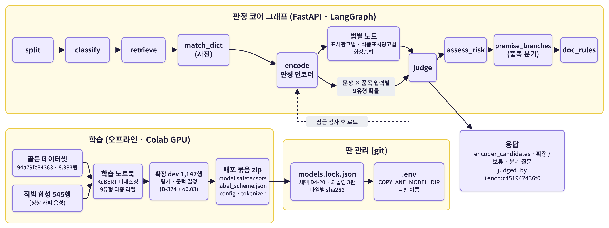
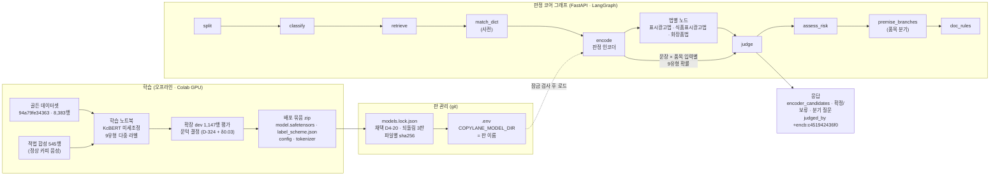

# 시스템 구성도 — 판정 인코더 파트 (박수진 · 2026-10-19)

> 이 문서는 팀장 작성 「시스템 구성도」(T4)에 넣을 **판정 인코더 박스의 재료**다. 그래프 전체 구조의 정본은 `docs/02_설계/AI_시스템_아키텍처.md`이고, 이 문서는 그 문서가 「다루지 않는 것」으로 넘긴 인코더 쪽(모델 · 학습 · 배포 판)만 적는다.
> 기준: `psj` `319aeef` (main #136 포함) · 채택 판 **D4-20** (`models.lock.json` roles.encoder.adopted · D-349) · 판 지문 `c451942436f0`

## 1. 한 장 그림

## 2. 인코더 박스 — 한 줄 정의

**광고 문장 하나와 품목을 받아 9가지 위반 유형의 확률을 내는 분류기.** 법 조항 판단은 하지 않는다. 판단은 그래프의 `judge` · 법별 노드가 하고, 인코더는 후보와 확신만 준다(D-131).

| 항목 | 값 |
|---|---|
| 기반 모델 | `beomi/kcbert-base` (한국어 BERT · 약 1.1억 파라미터) |
| 출력 | 9유형 다중 라벨 시그모이드 확률 |
| 9유형 | 질병_예방치료_표방 · 건강기능식품_오인 · 의약품_오인 · 거짓_과장 · 소비자_기만 · 후기_체험기_기만 · 부당_비교광고 · 비방광고 · 기능성화장품_오인 (D4-20에서 기능성 편입) |
| 입력 | (품목, 문장) 문장쌍 — 품목 = 식품 · 건기식 · 화장품 · 모름 · 최대 136 토큰 · 넘치면 문장 쪽만 자름 |
| 문턱 | 두 벌 — 「모름」 입력용(기록 판정) · 품목 입력용(분기 · 재검수) · `label_scheme.json`에 실림, 코드에 적지 않음 |
| 가중치 크기 | `model.safetensors` 435.7 MB |
| 실행 위치 | 앱 서버 프로세스 안 (PyTorch `inference_mode`) · 별도 서버 없음 |

## 3. 그래프 안에서의 자리

- **노드**: 코어 서브그래프의 5번째 `encode` — `split → classify → retrieve → match_dict → encode` 다음에 법별 팬아웃.
- **팬아웃 앞에서 한 번만 돈다**(D-267). 법마다 부르면 판정기가 세 벌이 된다(D-99).
- **한 배치로 여러 품목 입력**(D-339 결정 5): 문장마다 「요청 품목(모르면 모름)」 + 품목 분기 입력(식품 · 건기식 · 화장품)을 한꺼번에 돌린다. 기록 판정은 요청 품목 입력을, 분기는 그 전제의 입력을 읽는다.
- **상태 칸**: `encodings` (문장 id · 입력 · 9유형 점수 · 후보 · 잘림 여부) → `judge`가 응답의 `SentenceJudgment.encoder_candidates`로 옮긴다.
- **전제 거름 · 옮김**: 건기식 인정 · 비인정 전제는 건강기능식품_오인 후보를 빼거나 거짓_과장으로 옮기고, 화장품 전제는 질병 표방 · 건기식 오인을 의약품_오인으로 옮긴다(D-323 결정 6 · D-338).

## 4. 판정에 닿는 길 (10-19 기준)

| 경우 | 인코더가 하는 일 |
|---|---|
| 사전에 걸린 문장 | 후보 칸에만 싣는다 — 사전 판정이 우선 |
| 사전에 안 걸린 문장(인코더만 잡은 문장) | **인코더 쪽 판정**(D-348 보충 5) — 답 없이 확정하지 않고 보류 + 분기 질문(사실 확인 · 실증 · 인정 기능성) |
| 그중 법 축 칸이 C인 유형 · 품목이 정해짐 · 확신 ≥ τ | **절대형 확정**(답 없이 위반) — τ = 0.699 (D4-20 판 지문 `c451942436f0` 전용 · 보충 26) |
| 절대형에서 빼는 것 | 옮긴 근거(`moved_from`) · 화장품 의약품 오인 중 인증 · 실증 꼴과 기능성 정형 낱말뿐인 문장(보충 25 · 26) |
| 모델이 없거나 못 올림 | 경고를 남기고 규칙 판정만으로 간다(보류 쪽이라 안전) · 평가 도구는 멈춘다(D-220) |

## 5. 판 관리 · 배포

1. **학습**: Colab(GPU)에서 노트북 실행 → 시드 48 · 49 · 50 중 6종 PR-AUC 최고 시드를 배포(D4-20은 시드 49).
2. **묶음**: `make_d415_scheme.py`가 문턱을 계산해 `label_scheme.json`을 만들고 가중치와 함께 zip으로 묶는다.
3. **잠금**: `models.lock.json`에 파일별 sha256을 적고 채택 · 되돌림 판을 지정한다(D-333) — **잠금에 없는 판은 앱이 올리지 않는다.**
4. **선택**: 기기마다 `.env`의 `COPYLANE_MODEL_DIR=<판 이름>`(`launcher.py setting`)으로 잠금 안의 판을 고른다.
5. **표지**: 응답 `judged_by`에 `+encb:<판 지문 12자>`가 붙어 어느 판이 판정했는지 남는다.
6. **되돌림**: D4-10 · v10-카드17 · v10-합성O-이유O 세 판이 잠금에 되돌림 판으로 있다.

> 🔴 가중치 zip · 골든 · 행 CSV는 git에 올리지 않는다(D-249). 공유는 공유 저장소(`data-sync`)로만 한다.

## 6. 채택 판 수치 (발표 · 구성도 주석용)

| 지표 | D4-20 | 출처 |
|---|---|---|
| 확장 dev 6종 macro PR-AUC (배포 시드 49) | 0.715 | `label_scheme.json` |
| 학습 행 | 5,310 (식품 1,915 · 건기식 1,380 · 화장품 397 · 모름 1,618) | 같음 |
| 그래프 확인 — 분기 인코더 쪽 절대형 확정 | 18건 중 맞음 17 · 틀림 1 | D4 실험기록 10-19 |
| 그래프 확인 — flagged_any (G1) | 분기 446/482 · 기록 742/776 | 같음 |
| OpenAI 임베딩 대비 (E1-03) | PR-AUC large보다 +0.03 · small보다 +0.16~0.18 · 정상 카피 오탐은 OpenAI가 5~8배 | E1-03 보고서 |

> 봉인 평가셋(1,141행)은 봉인 회차 전까지 열지 않았다 — 위 수치는 모두 dev 기준이다(D-347 · D-175).

## 7. 구성도에 넣을 때 표기 제안

- 박스 이름: **「판정 인코더 (KcBERT 미세조정 · 9유형)」**
- 박스 안 한 줄: `문장 + 품목 → 9유형 확률 · 팬아웃 앞 1회`
- 들어오는 화살표: `match_dict` → `encode` · 판 관리(`models.lock.json` → `.env`)에서 점선
- 나가는 화살표: `encode` → 법별 노드 → `judge` (라벨: `encoder_candidates · 절대형 확정 τ 0.699`)
- 학습 쪽은 오프라인 박스로 따로(Colab · 골든 · dev 문턱 결정) — 서비스 경로와 선을 섞지 않는다
